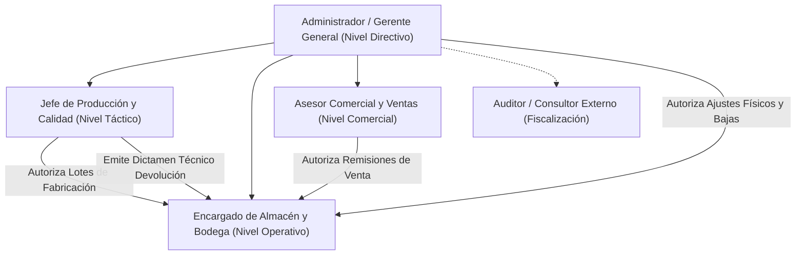
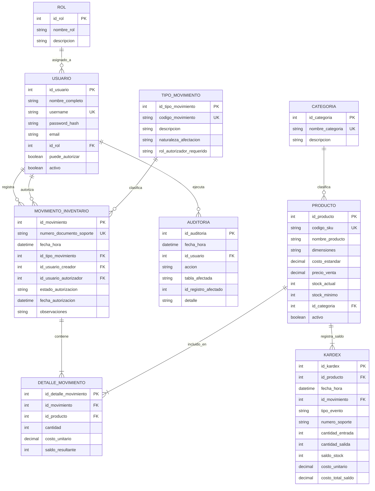

# PROYECTO INTEGRADOR — FASE II (SEMESTRE 4)
## SISTEMA DE GESTIÓN Y CONTROL DE INVENTARIOS DE PRODUCTO TERMINADO (ASADORES) PARA VOLCANO BARRILES (SIGEIV-VOLCANO FASE II)

---

### PORTADA INSTITUCIONAL Y DATOS DEL PROYECTO

* **Institución:** Institución Universitaria Antonio José Camacho (UNIAJC)  
* **Facultad:** Facultad de Ingenierías  
* **Programa Académico:** Tecnología en Sistemas de Información (PTSI)  
* **Asignaturas Integradoras (Semestre 4):**  
  * *Ingeniería de Software I* (Grupo 411)  
  * *Programación II* (Grupo 411)  
  * *Bases de Datos II* (Grupo 411)  
* **Periodo Académico:** 2026-2  
* **Equipo de Desarrollo:**  
  * Carlos Esneider Espitia Paz  
  * Angel Esteban Cuenú  
  * Kevin García Montoya  
  * Angela Perdomo Vélez  
* **Docente Asesor:** Javier Humberto Cortés  
* **Ubicación:** Santiago de Cali, Valle del Cauca, Colombia  
* **Fecha:** Noviembre de 2026  
* **Repositorio Oficial Git:** `https://github.com/CarlosEsneider/PI3`  

---

## 1. INTRODUCCIÓN Y CONTEXTO DEL NEGOCIO

### 1.1 Contexto Organizacional y Naturaleza Manufacturera
La microempresa **Volcano Barriles**, ubicada en Santiago de Cali, es una unidad productiva dedicada al **diseño, manufactura metalmecánica, ensamble, personalización y comercialización de asadores tipo barril en acero inoxidable** (láminas AISI 430 y AISI 304 de alta durabilidad) y accesorios parrilleros complementarios (parrillas abatibles, garfios descolgadores, termómetros análogos, fundas impermeables y carbón vegetal).

A diferencia de una simple empresa comercializadora de mercancías que compra productos terminados a distribuidores, **Volcano Barriles es una empresa MANUFACTURERA**. Sus dinámicas operativas y de información giran en torno a la sincronización bidireccional entre el **taller metalmecánico de fabricación** y la **bodega general de almacenamiento de producto terminado**:
1. **Flujo de Entrada:** Cada asador ingresa formalmente al inventario mediante **Lotes de Producción** respaldados por una *Orden de Entrega de Producción*, tras superar los procesos de corte, rolado, soldadura TIG, pulido, ensamble y control de calidad.
2. **Flujo de Salida:** Egresa a través de *Remisiones de Despacho por Venta*, *Devoluciones de Clientes* (con dictamen técnico de calidad) o *Actas de Baja por Merma Técnica* (daños irreparables durante flete o manufactura).

### 1.2 Transición de Fase I a Fase II
Durante el Semestre 3 (Fase I), el equipo desarrolló un prototipo enfocado en un esquema genérico de tienda comercial (CRUD básico de clientes, productos, ventas y compras). 

En el **Semestre 4 (Fase II)**, a partir de visitas de campo, entrevistas y levantamiento riguroso de información, se reestructuró el sistema para resolver la problemática medular de la empresa: **la ausencia de un Kardex automatizado e inmutable, la carencia de trazabilidad de lotes, la falta de un flujo jerárquico de autorizaciones y la inexistencia de alertas preventivas de stock**.

---

## 2. DIAGNÓSTICO OPERATIVO Y FORMULACIÓN DEL PROBLEMA

### 2.1 Problemáticas Operativas Identificadas
1. **Carencia de Trazabilidad Integral en Lotes y Despachos:** El catálogo activo supera las 65 referencias de producto terminado distribuidas en 5 líneas principales (Mini, Pequeño, Mediano, Grande, Jumbo y Accesorios). Los lotes ingresaban sin identificación formal de lote, fecha ni orden de producción (OP), imposibilitando rastrear hacia atrás garantías por fallas de soldadura o acabados.
2. **Ausencia de Flujo Jerárquico de Autorizaciones y Segregación de Funciones:** Cualquier colaborador podía retirar o ingresar asadores sin validación escrita ni aprobación del Administrador/Gerente, facilitando extracciones arbitrarias y diluyendo responsabilidades.
3. **Inexistencia de un Kardex Automatizado e Inmutable:** El control manual en libretas y hojas de cálculo no vinculadas provocaba mensualmente **discrepancias críticas de hasta el 18% entre el inventario físico en bodega y las existencias registradas**.
4. **Descontrol e Informalidad en los Ajustes Físicos:** Los descuadres se cuadraban empíricamente sin acta técnica de justificación de causa raíz (robos hormiga, errores de despacho o conteo) y sin autorización gerencial.
5. **Carencia de Registro Clasificado de Bajas:** No existía procedimiento formal para clasificar asadores golpeados, con defectos estéticos irreparables o dados de baja por flete.
6. **Inexistencia de Alertas Preventivas de Stock Mínimo:** La producción operaba de forma reactiva, generando sobreinventario en referencias de baja rotación (Jumbo) y quiebres de inventario (*stockouts*) en modelos de alta demanda (Medianos).
7. **Demoras en Consultas y Consolidación de Reportes:** Consultar existencias tomaba entre **8 y 12 minutos** por cliente (traslado físico a bodega), ocasionando pérdida de ventas. La consolidación contable de inventario requería hasta 3 días hábiles.

### 2.2 Formulación de la Pregunta de Investigación
> *¿De qué manera el desarrollo de un sistema de información especializado en la gestión y control del inventario de producto terminado, fundamentado en un Kardex multievento con documentos soporte, flujo jerárquico de autorizaciones, trazabilidad de lotes y alertas preventivas de stock, optimizará la exactitud de existencias y la eficiencia operativa en la empresa manufacturera Volcano Barriles?*

---

## 3. OBJETIVOS Y MATRIZ DE ALINEACIÓN TRANSVERSAL

### 3.1 Objetivo General
Desarrollar un sistema de información para la gestión y control integral del inventario de producto terminado (asadores y accesorios) en la microempresa manufacturera Volcano Barriles, que garantice la trazabilidad de existencias en tiempo real mediante el registro riguroso de movimientos de almacén (entradas por lotes de producción, salidas por ventas, devoluciones de clientes, ajustes físicos y bajas autorizadas), respaldado por un esquema formal de validación y autorización según la jerarquía organizacional, optimizando la exactitud del Kardex y la toma de decisiones comerciales y operativas.

### 3.2 Objetivos Específicos (SMART)
* **OE1 (Módulo de Catálogo y Clasificación Técnica):** Administrar códigos SKU alfanuméricos únicos, especificaciones técnicas de ensamble, dimensiones, precios de venta, costos estándar de fabricación y umbrales de stock mínimo de seguridad.
* **OE2 (Módulo de Kardex Multievento y Trazabilidad Documental):** Registrar, clasificar y asentar en un Kardex inmutable los movimientos de almacén a partir de documentos soporte formales numerados consecutivamente (lotes validados por Producción, despachos de venta y devoluciones con dictamen técnico).
* **OE3 (Módulo de Gestión de Autorizaciones Jerárquicas, Ajustes Físicos y Bajas):** Construir el subsistema de conciliación y control interno que permita a los roles facultados autorizar digitalmente las transacciones que alteran saldos (actas de ajuste por conteo físico y actas de baja por merma técnica).
* **OE4 (Módulo de Alertas Preventivas de Stock y Reportes Analíticos Gerenciales):** Diseñar el componente analítico que emita alertas visuales automáticas de stock crítico y preventivo por semaforización, calcule la rotación de asadores y valorice económicamente el inventario disponible.

### 3.3 Matriz de Alineación Transversal del Proyecto

#### Tabla 1
*Matriz de Concordancia Transversal: Problema Identificado, Necesidad, Objetivo, Solución y Requerimientos*

| Situación Problemática | Necesidad Operativa Concreta | Objetivo Específico | Solución Esperada en el Sistema | Requerimientos Asociados |
|---|---|---|---|---|
| **Dispersión en el catálogo activo:** >65 referencias sin SKU homogéneo, dimensiones ni umbrales de seguridad. | Estandarizar catálogo con identificación única, ficha técnica y stock mínimo. | **OE1** (Catálogo Técnico) | Módulo de catálogo con SKU único, especificaciones técnicas, dimensiones, costo estándar y umbral de seguridad. | `RF-02`, `RF-03`, `RF-04`, `RNF-01` |
| **Registro empírico sin Kardex ni documentos soporte:** 18% de descuadre mensual y nula trazabilidad. | Disponer de un registro cronológico, secuencial e inalterable que calcule saldos a partir de documentos soporte. | **OE2** (Kardex Multievento) | Subsistema de Kardex automatizado con entradas por lote (OP), salidas por venta y devoluciones con dictamen técnico. | `RF-05`, `RF-06`, `RF-07`, `RF-10`, `RNF-02`, `RNF-04` |
| **Ausencia de autorizaciones y descontrol en ajustes/bajas:** Movimientos arbitrarios y ajustes sin justificación. | Establecer barreras de control interno y segregación de funciones donde toda alteración requiera firma digital del rol competente. | **OE3** (Autorizaciones y Bajas) | Bandeja centralizada de autorizaciones pendientes, actas de ajuste con causa raíz y registro tipificado de bajas de mercancía. | `RF-01`, `RF-08`, `RF-09`, `RNF-03`, `RNF-05` |
| **Carencia de alertas preventivas y reportes lentos:** Demoras de 8-12 min por consulta, compras reactivas y demora de 3 días en reportes. | Contar con alertas tempranas de desabastecimiento y reportes analíticos instantáneos de rotación y valorización. | **OE4** (Alertas y Reportes) | Tablero analítico con semaforización de alertas (verde, amarillo, rojo), reportes de rotación y valorización económica del stock. | `RF-11`, `RF-12`, `RNF-06`, `RNF-07` |

*Nota.* Elaboración propia bajo los lineamientos metodológicos de Ingeniería de Software I y Bases de Datos II (UNIAJC).

---

## 4. ESPECIFICACIÓN FORMAL DE REQUERIMIENTOS

### 4.1 Requerimientos Funcionales (RF-01 a RF-12)
* **`RF-01` Autenticación y Control de Sesión de Usuarios:** Acceso mediante credenciales con hash SHA-256, carga dinámica de permisos según los 5 roles jerárquicos y bloqueo preventivo tras 3 intentos fallidos consecutivos.
* **`RF-02` Gestión de Cuentas de Usuario, Roles y Niveles de Aprobación (CRUD):** Administración de colaboradores con asignación de rol, correo institucional, facultad de autorización (`puede_autorizar`) y borrado lógico (`activo = false`).
* **`RF-03` Gestión de Categorías y Líneas de Asadores:** Clasificación en líneas comerciales de fabricación: Barril Mini, Pequeño, Mediano, Grande, Jumbo, Accesorios Parrilleros y Carbón.
* **`RF-04` Gestión del Catálogo de Productos Terminados (Asadores):** Ficha técnica con SKU alfanumérico único, nombre, dimensiones/calibre, costo estándar de fabricación en taller, precio comercial, stock mínimo y borrado lógico. El stock físico inicial es cero y **solo se altera mediante documentos soporte autorizados**.
* **`RF-05` Registro y Autorización de Entradas por Lotes de Producción:** Generación de la *Orden de Entrega de Producción* por Almacén (N.° lote, OP origen, cantidades) en estado `PENDIENTE`. Certificación de acabados y autorización digital por el Jefe de Producción/Calidad para impactar stock y Kardex.
* **`RF-06` Registro y Autorización de Salidas por Ventas y Despachos:** Emisión de la *Remisión de Despacho de Venta* avalada por el Asesor Comercial y confirmada por Almacén, descontando existencias y asentando en Kardex en tiempo real.
* **`RF-07` Registro, Dictamen Técnico y Autorización de Devoluciones de Clientes:** Radicación de devolución asociada a factura original, emisión obligatoria de *Dictamen Técnico de Calidad* (Apto para reingreso, Requiere reproceso en taller o Daño no imputable) y actualización del Kardex según procedencia.
* **`RF-08` Control y Autorización de Ajustes por Inventario Físico (Faltantes y Sobrantes):** Registro de conteo físico comparativo, cálculo automático de discrepancia (sobrante = entrada, faltante = salida) con justificación obligatoria de causa raíz y **autorización indelegable de Gerencia General**.
* **`RF-09` Registro y Autorización de Salidas por Bajas y Mermas:** Retiro definitivo de asadores con averías irreparables mediante *Acta de Baja de Mercancía*, solicitada por Producción/Almacén y **aprobada exclusivamente por Gerencia General**.
* **`RF-10` Consulta del Kardex y Trazabilidad Documental:** Hoja de vida inmutable de cada referencia con historial cronológico de entradas, salidas, saldos resultantes, documentos soporte asociados y firmas de usuarios creadores y autorizadores.
* **`RF-11` Monitoreo de Stock en Tiempo Real y Alertas de Reabastecimiento:** Tablero con semaforización visual de stock: Verde (Óptimo), Amarillo (Preventivo: $\le 1.5 \times \text{stock\_minimo}$) y Rojo (Crítico o Agotado: $\le \text{stock\_minimo}$).
* **`RF-12` Generación de Reportes Analíticos de Inventario, Rotación y Auditoría:** Generación instantánea de informes consolidados de valorización económica (por costo estándar y valor de venta), rotación de modelos, histórico de mermas y bitácora de auditoría forense con exportación a PDF/Excel.

### 4.2 Requerimientos No Funcionales (RNF-01 a RNF-08)
* **`RNF-01` (Arquitectura):** Implementación bajo el patrón Modelo-Vista-Controlador (MVC) desacoplando presentación, persistencia y reglas de negocio.
* **`RNF-02` (Rendimiento):** Tiempo de respuesta en consultas de inventario, filtrado de Kardex y autorizaciones inferior a 1.5 segundos.
* **`RNF-03` (Seguridad):** Cifrado criptográfico unidireccional SHA-256 para contraseñas; prohibido texto plano.
* **`RNF-04` (Integridad y Prevención de Inyección SQL):** Uso del 100% de consultas preparadas (`PreparedStatement`) y llamadas a Stored Procedures (`CallableStatement`).
* **`RNF-05` (Usabilidad):** Interfaz gráfica ergonómica en Java Swing con bandeja centralizada de autorizaciones y semaforización visual.
* **`RNF-06` (Concurrencia):** Control transaccional ACID en motor de base de datos relacional con nivel de aislamiento *Read Committed*.
* **`RNF-07` (Manejo de Excepciones):** Captura rigurosa (`try-catch` con `SQLException`) con cuadros de diálogo comprensibles para el usuario (`JOptionPane`).
* **`RNF-08` (Portabilidad):** Compatibilidad con Java SE 17 LTS o superior sobre sistemas operativos Microsoft Windows 10/11 x64.

---

## 5. ESTRUCTURA DE ROLES Y MATRIZ DE AUTORIZACIONES

Para garantizar el control interno en una manufacturera, cada rol cuenta con responsabilidades estrictamente delimitadas:

#### Tabla 2
*Matriz de Control de Acceso y Nivel de Autorización por Documento Soporte*

| Módulo / Documento Soporte | Administrador / Gerente | Jefe de Producción y Calidad | Encargado de Almacén | Asesor Comercial | Auditor / Consultor |
|---|:---:|:---:|:---:|:---:|:---:|
| **Autenticación y Sesión** | Total | Total | Total | Total | Total |
| **Gestión Usuarios y Roles** | Total (CRUD) | Sin Acceso | Sin Acceso | Sin Acceso | Sin Acceso |
| **Catálogo de Asadores** | Total (CRUD) | Crear / Editar Ficha | Consulta Técnica | Solo Precios | Solo Consulta |
| **Entrada Lote Producción** | Supervisión | **Autoriza Lote (Certifica)** | **Registra Recepción** | Sin Acceso | Solo Consulta |
| **Salida Venta / Despacho** | Supervisión | Sin Acceso | **Despacho Físico** | **Autoriza Venta** | Solo Consulta |
| **Devoluciones de Clientes** | Supervisión | **Dictamen y Aval Técnico** | Reingreso Físico | **Radica Solicitud** | Solo Consulta |
| **Ajuste Inventario Físico** | **Autoriza Ajuste** | Sin Acceso | **Registra Conteo** | Sin Acceso | Solo Consulta |
| **Baja de Mercancía / Merma** | **Aprueba Baja** | **Solicita Baja Técnica** | Custodia Merma | Sin Acceso | Solo Consulta |
| **Kardex y Trazabilidad** | Total | Kardex de Taller | Movimientos Propios | Stock Disponible | Total Auditoría |
| **Reportes Analíticos** | Total y Exportar | Reporte Producción | Reporte Existencias | Sin Acceso | Total y Exportar |
| **Bitácora de Auditoría** | Total (Inalterable) | Sin Acceso | Sin Acceso | Sin Acceso | Total (Inalterable) |

---

## 6. MODELADO DE DATOS (MER EN 3FN) Y OBJETOS AVANZADOS

El sistema se normalizó en **Tercera Forma Normal (3FN)** articulando 9 tablas relacionales:

### 6.1 Objetos Avanzados de Base de Datos
* **Procedimiento Almacenado `sp_autorizar_movimiento_inventario`:** Valida el rol facultado, comprueba suficiencia de stock en salidas, actualiza `stock_actual` en `PRODUCTO`, genera la fila cronológica en `KARDEX` y sella la `AUDITORIA` dentro de una transacción `COMMIT/ROLLBACK`.
* **Procedimiento Almacenado `sp_solicitar_ajuste_inventario`:** Procesa conteos de bodega, determina discrepancias y crea el documento en estado `'PENDIENTE'`.
* **Trigger `trg_auditoria_autorizaciones`:** Dispara automáticamente la bitácora ante transacciones de aprobación o rechazo de documentos soporte.
* **Vistas Analíticas:** `vw_kardex_general` (historial consolidado con nombres de usuarios y soportes), `vw_alertas_stock_critico` (semaforización de existencias) y `vw_valorizacion_inventario` (valor económico del stock por línea).

---

## 7. DIAGNÓSTICO DEL ESTADO ACTUAL DE LA APLICACIÓN

### 7.1 Lo que ya está construido y probado en código (Backend Java):
* **Entidades POO completas:** `MovimientoInventario`, `DetalleMovimiento`, `Kardex`, `Auditoria`, `TipoMovimiento`, `EstadoAutorizacion`.
* **Reglas de Negocio en Java:** Métodos `autorizar(Usuario u)` y `rechazar(Usuario u, String motivo)` con validación de saldo suficiente en salidas, verificación de roles y sellado de fecha.
* **Persistencia Transaccional (DAO):** `MovimientoInventarioDAO.java` con transacciones ACID (`setAutoCommit(false)`, `commit()`, `rollback()`) y desacoplamiento para SQLite.
* **Controladores MVC:** `MovimientoInventarioController.java` y `ProductoController.java`.
* **Suite de Pruebas Unitarias:** `TestVerificacionS4.java` (pruebas de integración superadas con 0 fallos).

### 7.2 La Gran Brecha: Lo que falta en la interfaz de usuario (GUI Swing):
A pesar de que el backend funciona, **la interfaz gráfica sigue mostrando únicamente las 10 ventanas del prototipo de Semestre 3 (Fase 1)**:
1. No existe la pantalla para registrar **Lotes de Producción, Devoluciones con Dictamen, Ajustes Físicos ni Bajas**.
2. No existe la **Bandeja Centralizada de Autorizaciones** para que los roles directivos aprueben o rechacen documentos.
3. No existe el visor interactivo de **Kardex**.
4. En `ProductoPanel`, falta el SKU, dimensiones y costo estándar; además, **el stock se puede editar manualmente**, lo que viola la regla de negocio del Kardex.
5. En `UsuarioPanel` y `MainFrame`, solo existen 3 roles arcaicos en vez de los 5 roles jerárquicos documentados.
6. En `ReportePanel`, solo hay reportes de ventas de clientes; no existen los reportes de inventario, valorización ni mermas.

---

## 8. PLAN DE ACCIÓN RECOMENDADO PARA IMPLEMENTAR EN LA APP

Para llevar la aplicación al cumplimiento riguroso de la documentación de Fase 2 y asegurar la calificación máxima de 5.0 (Nivel Relacional UNIAJC), se define la siguiente hoja de ruta de implementación técnica:

### Fase 1: Alineación de Entidades POO y Formulario de Productos (RF-04)
1. **Actualizar `Producto.java`:**
   - Incorporar atributos: `codigoSku` (String), `dimensiones` (String), `costoEstandar` (double) y `activo` (boolean).
   - Generar getters, setters y constructor sobrecargado.
2. **Actualizar `ProductoDAO.java`:**
   - Adaptar sentencias SQL `INSERT` y `UPDATE` para incluir `codigo_sku`, `dimensiones`, `costo_estandar` y `activo`.
   - Modificar la eliminación para que sea **borrado lógico** (`UPDATE producto SET activo = 0 WHERE id_producto = ?`).
3. **Refactorizar `ProductoPanel.java`:**
   - Agregar campos de texto para SKU, dimensiones técnicas y costo estándar de taller.
   - **Deshabilitar la edición del campo `txtStockActual` (`txtStockActual.setEditable(false)`):** Mostrar una etiqueta que indique claramente que el stock solo se incrementa o disminuye mediante documentos soporte autorizados.

### Fase 2: Actualización de Seguridad, Roles y Navegación (RF-01, RF-02)
1. **Actualizar `Usuario.java` y `UsuarioDAO.java`:**
   - Agregar campos `email` (String) y `puedeAutorizar` (boolean).
2. **Actualizar `UsuarioController.java` y `UsuarioPanel.java`:**
   - Reemplazar los 3 roles viejos por el catálogo oficial de 5 roles:
     * `1 - Administrador / Gerente General`
     * `2 - Jefe de Producción y Calidad`
     * `3 - Encargado de Almacén y Bodega`
     * `4 - Asesor Comercial / Ventas`
     * `5 - Auditor / Consultor Externo`
   - Incorporar en el formulario el campo `txtEmail` y el checkbox `chkPuedeAutorizar`.
3. **Refactorizar `LoginFrame.java`:**
   - Añadir contador de intentos fallidos. Al tercer intento consecutivo erróneo, bloquear temporalmente el acceso con aviso emergente en `JOptionPane`.
4. **Refactorizar `MainFrame.java`:**
   - Actualizar el método `obtenerNombreRol(int idRol)` para reconocer los 5 roles.
   - Configurar la visibilidad de los botones del Sidebar aplicando de forma estricta la **Matriz de Control de Acceso (Tabla 2)**.

### Fase 3: Construcción de la Bandeja de Autorizaciones Pendientes (OE3, RNF-05)
1. **Crear `AutorizacionesPanel.java` en `com.sigeiv.vista`:**
   - **Tabla Superior:** Listado de documentos en estado `PENDIENTE` consultados mediante `MovimientoInventarioController.listarPendientes()`. Columnas: *ID, N.° Documento, Fecha/Hora, Tipo Movimiento, Usuario Creador, Observaciones*.
   - **Panel Inferior / Lateral de Detalle:** Al hacer clic en un movimiento, cargar la lista de asadores del `DetalleMovimiento` (Producto, SKU, Cantidad solicitada, Costo unitario, Stock actual en bodega).
   - **Botón `[Autorizar Documento]`:**
     * Verifica que el usuario logueado tenga rol autorizado según el tipo de movimiento:
       - Lote de Producción / Devolución $\rightarrow$ Requiere *Jefe de Producción* o *Administrador*.
       - Ajuste Físico / Baja Técnica $\rightarrow$ Requiere *Administrador / Gerente*.
       - Despacho de Venta $\rightarrow$ Requiere *Asesor Comercial* o *Administrador*.
     * Invoca `movimientoCtrl.autorizarMovimiento(idMovimiento, usuarioLogueado)`.
     * Emite mensaje de éxito, actualiza la tabla y refresca las existencias.
   - **Botón `[Rechazar Documento]`:**
     * Despliega un cuadro de diálogo solicitando la justificación obligatoria del rechazo.
     * Invoca `movimientoCtrl.rechazarMovimiento(idMovimiento, usuarioLogueado, motivo)`.

### Fase 4: Registro de Movimientos de Inventario y Documentos Soporte (RF-05, RF-07, RF-08, RF-09)
1. **Crear `MovimientoInventarioPanel.java` en `com.sigeiv.vista`:**
   - Pestañas o selector de tipo de documento:
     * **Pestaña 1: Orden de Entrega de Lote (Producción - RF-05):** Permite al Almacén seleccionar asadores ensamblados, ingresar cantidad del lote y N.° de Orden de Producción origen.
     * **Pestaña 2: Acta de Devolución de Cliente (RF-07):** Radica devolución vinculada a factura con combo de Dictamen Técnico (Apto / Reproceso / Daño no imputable).
     * **Pestaña 3: Acta de Ajuste Físico por Conteo (RF-08):** Permite ingresar el conteo físico, calcula automáticamente la discrepancia (faltante o sobrante) y exige la causal técnica justificada.
     * **Pestaña 4: Acta de Baja por Merma Técnica (RF-09):** Permite dar de baja asadores con daño irreparable indicando motivo.
   - Al presionar **[Radicar Documento Soporte]**, se crea el `MovimientoInventario` con sus `DetalleMovimiento` en estado `PENDIENTE` y se notifica que ha quedado listo para revisión en la Bandeja de Autorizaciones.
2. **Conectar `VentaPanel.java` con `MovimientoInventario` (RF-06):**
   - Modificar la confirmación de venta para que, en lugar de invocar `actualizarStock()` directo, instancie un `MovimientoInventario` de tipo `SAL_VENT` con número de remisión de despacho y lo procese a través del flujo transaccional.

### Fase 5: Visor Interactivo de Kardex y Trazabilidad (RF-10, RF-11)
1. **Crear `KardexPanel.java` (o integrar pestaña avanzada en `InventarioPanel.java`):**
   - Selector desplegable de producto con filtro por código SKU o nombre.
   - Grilla con columnas: *ID Kardex, Fecha/Hora, Tipo Evento, N.° Soporte, Registrado Por, Autorizado Por, Entrada (+), Salida (-), Saldo Stock, Costo Unitario, Saldo Valorizado*.
   - Invoca `movimientoCtrl.listarKardexPorProducto(idProducto)`.
2. **Mejorar `InventarioPanel.java` (Semaforización Visual - RF-11):**
   - Configurar el renderer de la tabla con la semaforización oficial tricolor:
     * **Verde (Óptimo):** $\text{Stock} > \text{Stock Mínimo} \times 1.5$.
     * **Amarillo (Preventivo):** $\text{Stock Mínimo} < \text{Stock} \le \text{Stock Mínimo} \times 1.5$.
     * **Rojo (Crítico / Agotado):** $\text{Stock} \le \text{Stock Mínimo}$ o $\text{Stock} = 0$.
   - Agregar panel resumen con contador de referencias críticas para alerta inmediata al taller.

### Fase 6: Reportes Analíticos de Inventario y Auditoría (RF-12)
1. **Ampliar `ReportePanel.java`:**
   - Incorporar pestañas o selector de reportes:
     * *Reporte de Ventas Comerciales* (existente).
     * *Valorización Económica del Inventario:* Total unidades por línea, valorización por costo estándar de fabricación y valorización a precio comercial.
     * *Reporte de Rotación de Asadores:* Referencias de mayor movimiento vs. modelos inmovilizados.
     * *Historial de Bajas y Mermas:* Resumen de asadores dados de baja con causales técnicas.
     * *Bitácora de Auditoría Forense:* Registro inmutable de autorizaciones, rechazos y modificaciones sensibles.
   - Implementar botón **[Exportar Reporte a PDF / CSV]**.

### Fase 7: Validación Transaccional y Empaquetado Final
1. Ejecutar la suite de pruebas unitarias y de integración `TestVerificacionS4.java`.
2. Probar los flujos completos de caja negra para los 5 roles iniciando sesión con cada perfil.
3. Actualizar el script de construcción `package.bat` para compilar el código nuevo en `APP/bin/`, regenerar el archivo JAR con manifiesto actualizado y empaquetar el ejecutable final `SIGEIV-Volcano-Unico.exe`.

---

## 9. REFERENCIAS BIBLIOGRÁFICAS (NORMAS APA 7.ª EDICIÓN)

* Ballou, R. H. (2004). *Logística: Administración de la cadena de suministro* (5.ª ed.). Pearson Educación.
* Chase, R. B., Jacobs, F. R., & Aquilano, N. J. (2018). *Administración de operaciones: Producción y cadena de suministros* (15.ª ed.). McGraw-Hill Interamericana.
* Date, C. J. (2004). *Introducción a los sistemas de bases de datos* (8.ª ed.). Pearson Educación.
* Deitel, P., & Deitel, H. (2017). *Java: Cómo programar* (10.ª ed.). Pearson Educación.
* Elmasri, R., & Navathe, S. B. (2016). *Fundamentals of database systems* (7.ª ed.). Pearson.
* Fowler, M. (2003). *Patterns of enterprise application architecture*. Addison-Wesley Professional.
* Kendall, K. E., & Kendall, J. E. (2011). *Análisis y diseño de sistemas* (8.ª ed.). Pearson Educación.
* Oracle Corporation. (2024). *MySQL 8.0 Reference Manual: Stored programs, triggers and views*. Oracle Documentation. https://dev.mysql.com/doc/
* Pressman, R. S. (2010). *Ingeniería del software: Un enfoque práctico* (7.ª ed.). McGraw-Hill Interamericana.
* Silberschatz, A., Korth, H. F., & Sudarshan, S. (2014). *Fundamentos de bases de datos* (6.ª ed.). McGraw-Hill Interamericana.
* Sommerville, I. (2016). *Ingeniería del software* (10.ª ed.). Pearson Educación.

