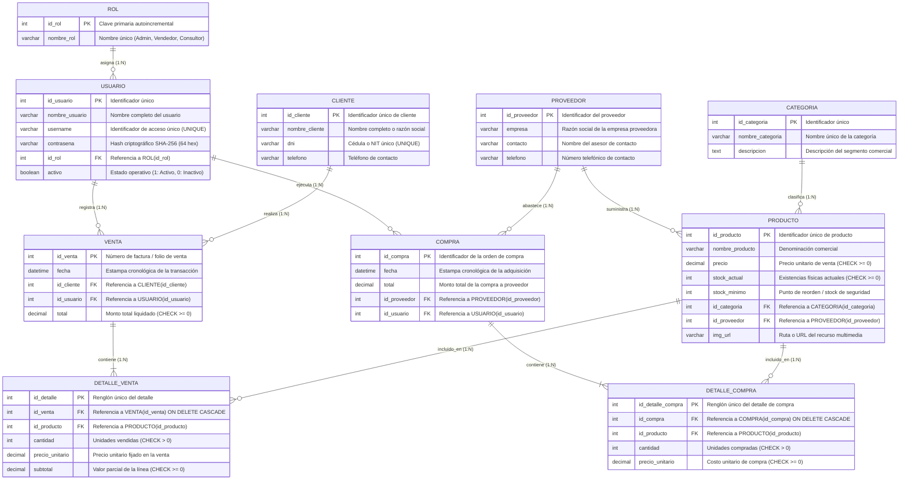

# INSTITUCIÓN UNIVERSITARIA ANTONIO JOSÉ CAMACHO
## FACULTAD DE INGENIERÍAS — TECNOLOGÍA EN SISTEMAS DE INFORMACIÓN
### PROYECTO INTEGRADOR CUARTO SEMESTRE (PI 411 / 412 / 413)

---

# SIGEIV-VOLCANO
## SISTEMA DE INFORMACIÓN PARA LA GESTIÓN DE INVENTARIOS, COMPRAS Y FACTURACIÓN DE VENTAS EN LA EMPRESA VOLCANO BARRILES

### DOCUMENTO DE ESPECIFICACIÓN TÉCNICA — PRIMERA ENTREGA (FASE 1 - SEMANA 5)

---

**Integrantes del Equipo de Desarrollo:**
*   **Kevin García** — Código Estudiantil / Rama de Desarrollo
*   **Carlos Esneider Espitia Paz** — ceespitia@estudiante.uniajc.edu.co
*   **Esteban Muñoz Ordóñez**
*   **Leandro Caldón Fernández**
*   **Mauricio Alberto Ledesma**

**Asignaturas Integradas:**
*   **Ingeniería de Software 1** (PI 411)
*   **Programación 2** (PI 412)
*   **Bases de Datos 2** (PI 413)

**Docentes Asesores:**
*   Docente de Ingeniería de Software 1
*   Docente de Programación 2
*   Docente de Bases de Datos 2

**Santiago de Cali, Valle del Cauca, Colombia**  
**Mayo de 2026**

---

## TABLA DE CONTENIDO

1.  **CAPÍTULO 1. PLANTEAMIENTO DEL PROBLEMA**
    *   1.1. Contextualización y Comprensión del Negocio
    *   1.2. Datos y Cifras Cuantitativas del Negocio
    *   1.3. Respaldo Bibliográfico y Teórico
    *   1.4. Formulación de la Pregunta de Investigación
2.  **CAPÍTULO 2. OBJETIVOS DEL PROYECTO (METODOLOGÍA SMART)**
    *   2.1. Objetivo General
    *   2.2. Objetivos Específicos
3.  **CAPÍTULO 3. JUSTIFICACIÓN DEL PROYECTO**
    *   3.1. Beneficios Esperados
    *   3.2. Impacto en el Negocio
    *   3.3. Viabilidad y Sostenibilidad (Técnica, Económica, Operativa)
    *   3.4. Apoyo y Aceptación Institucional
4.  **CAPÍTULO 4. METODOLOGÍA DE DESARROLLO DE SOFTWARE**
    *   4.1. Justificación de la Metodología (Scrum Adaptado)
    *   4.2. Fases del Proceso de Desarrollo
    *   4.3. Cronograma de Sprints y Entregables
5.  **CAPÍTULO 5. MODELO DEL NEGOCIO Y ROLES DE USUARIO**
    *   5.1. Modelo del Negocio y Cadena de Valor (Volcano Barriles)
    *   5.2. Definición de Roles de Usuario y Matriz de Privilegios
6.  **CAPÍTULO 6. DIAGRAMA DE CLASES (UML 2.5)**
    *   6.1. Estructura de Clases del Dominio y Capas MVC / DAO
    *   6.2. Diagrama de Clases UML Completo
    *   6.3. Justificación de Tipos de Datos y Relaciones
7.  **CAPÍTULO 7. MODELO ENTIDAD-RELACIÓN (DER) Y DISEÑO FÍSICO**
    *   7.1. Diagrama Entidad-Relación (DER)
    *   7.2. Especificación de Entidades y Diccionario de Datos
    *   7.3. Justificación de Cardinalidades y Normalización (3FN)
8.  **CAPÍTULO 8. REFERENCIAS BIBLIOGRÁFICAS (NORMAS APA 7.ª EDICIÓN)**

---

# CAPÍTULO 1. PLANTEAMIENTO DEL PROBLEMA

## 1.1. Contextualización y Comprensión del Negocio
La microempresa **Volcano Barriles** es una iniciativa manufacturera y comercial establecida en la ciudad de Santiago de Cali (Valle del Cauca), especializada en el diseño, manufactura y comercialización de barriles asadores y ahumadores de acero al carbón e inoxidable, además de una variada línea de accesorios parrilleros, carbón vegetal, briquetas y adobos artesanales para barbacoa.

A partir del levantamiento diagnóstico y las entrevistas realizadas in situ con los encargados del taller y mostrador comercial, se constató que las operaciones cotidianas se desarrollan de forma empírica y descentralizada, mediante anotaciones manuales en cuadernos y planillas de cálculo sin sincronización transaccional ni copias de seguridad automáticas.

Esta situación ocasiona inconsistencias operativas críticas:
1.  **Desfase en tiempo real de inventarios:** Las ventas efectuadas en mostrador o mediante pedidos mayoristas para restaurantes campestres no descuentan inmediatamente las existencias del catálogo general, produciendo compromisos comerciales sobre mercancía inexistente (*quiebre de stock*).
2.  **Carencia de puntos de reorden:** No existen alarmas automatizadas de existencias mínimas para piezas y consumibles indispensables (carbón, rejillas, termómetros), lo que paraliza despachos y obliga a realizar compras urgentes con sobrecostos logísticos.
3.  **Falta de control en compras a proveedores:** Las órdenes a distribuidores metalúrgicos carecen de una correlación sistematizada frente al incremento de unidades físicas en inventario y ante los precios de adquisición fluctuantes.
4.  **Cálculo manual en facturación:** La liquidación de totales por pedido recae en el cálculo manual del dependiente, lo que deriva en errores aritméticos frecuentes y descuadres al cierre de caja.

## 1.2. Datos y Cifras Cuantitativas del Negocio
*   **Puntos de operación y personal:** 1 sede operativa integral (taller y sala de ventas) en Cali, atendida por 5 colaboradores directos.
*   **Líneas de producto administradas:** Catálogo activo con más de 15 referencias fijas clasificadas en 10 categorías (barriles 100L, 200L, ahumadores pro, accesorios, insumos combustibles, adobos y repuestos), movilizando un promedio de 400 unidades físicas al mes.
*   **Proveedores y clientes:** Relación con 10 proveedores metalúrgicos y de suministros, y una base de más de 150 clientes entre personas naturales, asaderos y empresas de eventos BBQ.
*   **Flujo transaccional:** Entre 10 y 15 ventas diarias con tiques que oscilan entre \$12.000 COP y \$1.000.000 COP.
*   **Tiempo improductivo registrado:** Entre **12 y 15 horas a la semana** desperdiciadas en conteos físicos de repetición, cuadres de caja y resolución de discrepancias en papel.
*   **Pérdidas económicas estimadas:** Pérdidas por ventas frustradas y mermas en inventario valoradas entre **\$1.800.000 y \$2.500.000 COP al mes**.

## 1.3. Respaldo Bibliográfico y Teórico
La teoría de administración de operaciones y de ingeniería de software sustenta la necesidad imperativa de sistematizar este tipo de procesos. Ballou (2004) advierte que la visibilidad deficiente sobre las existencias desencadena el denominado *efecto látigo*, distorsionando la cadena de suministro e incrementando los costos operativos. Por su parte, Laudon y Laudon (2020) resaltan que los sistemas de información transaccionales estructurados sobre bases de datos relacionales garantizan la integridad referencial y proveen información confiable para la toma de decisiones. Asimismo, autores como Sommerville (2019) y Pressman y Maxim (2021) destacan que arquitecturas desacopladas como el patrón Modelo-Vista-Controlador (MVC) en entornos orientados a objetos (Java) brindan la mantenibilidad, extensibilidad y estabilidad requeridas por organizaciones en crecimiento.

## 1.4. Formulación de la Pregunta de Investigación
> **¿Cómo el desarrollo e implementación de un sistema de información de escritorio basado en el patrón arquitectónico Modelo-Vista-Controlador (MVC), lenguaje de programación Java y una base de datos relacional normalizada, puede optimizar el control de inventario, la gestión de compras a proveedores y la trazabilidad del proceso de facturación de ventas en la microempresa Volcano Barriles?**

---

# CAPÍTULO 2. OBJETIVOS DEL PROYECTO (METODOLOGÍA SMART)

## 2.1. Objetivo General
Desarrollar una solución informática de escritorio orientada a objetos bajo el patrón arquitectónico Modelo-Vista-Controlador (MVC), lenguaje Java y un sistema de gestión de base de datos relacional normalizado para la microempresa Volcano Barriles, con el propósito de sistematizar, controlar y optimizar los procesos de administración de inventarios, compras a proveedores y registro de ventas durante el primer periodo académico de 2026.

## 2.2. Objetivos Específicos
1.  **Diagnosticar y especificar los requerimientos del sistema:**  
    Levantar y documentar formalmente las necesidades funcionales (RF) y no funcionales (RNF) de Volcano Barriles mediante técnicas de ingeniería de requisitos (entrevistas semiestructuradas, revisión documental y matrices IPO), estructurando las historias de usuario y casos de uso detallados según el estándar institucional UNIAJC.
2.  **Diseñar los modelos conceptuales, lógicos y arquitectónicos:**  
    Modelar la arquitectura técnica del sistema mediante diagramas estándar de la notación UML 2.5 (diagramas de clases estructurales, casos de uso e interacción de actividades) y el diseño de la base de datos mediante el Modelo Entidad-Relación (DER) normalizado en Tercera Forma Normal (3FN), garantizando la integridad de llaves primarias y foráneas.
3.  **Construir el aplicativo de escritorio y la capa de persistencia:**  
    Programar los módulos de software en lenguaje Java 17 aplicando el patrón arquitectónico MVC, el patrón Data Access Object (DAO), componentes gráficos interactivos con Java Swing (`JTable`, `JComboBox`, interfaces reactivas con `SwingWorker`) y la capa de acceso a datos relacional mediante JDBC, sentencias SQL parametrizadas y algoritmos criptográficos (SHA-256) para la seguridad de credenciales.
4.  **Validar y evaluar la operatividad del sistema:**  
    Ejecutar planes de pruebas funcionales de caja negra y pruebas de consistencia transaccional sobre la base de datos (descuento e incremento automático de stock, control de stock mínimo y prevención de inyecciones SQL), verificando la usabilidad y satisfacción operativa con los usuarios finales de Volcano Barriles.

---

# CAPÍTULO 3. JUSTIFICACIÓN DEL PROYECTO

## 3.1. Beneficios Esperados
*   **Exactitud en existencias:** Control automático de entradas y salidas que anula discrepancias entre existencias físicas y registros digitales.
*   **Prevención de desabastecimiento:** Notificación visual inmediata ante productos en riesgo de agotamiento ($\text{stock\_actual} \le \text{stock\_minimo}$).
*   **Agilidad en el servicio:** Disminución en el tiempo de liquidación de órdenes de venta de 10 minutos a menos de 90 segundos.
*   **Auditoría y control:** Trazabilidad histórica completa de transacciones de ventas y compras a proveedores por usuario y fecha.

## 3.2. Impacto en el Negocio
*   **Mayor competitividad:** Tiempos de despacho confiables para clientes mayoristas y del canal gastronómico en Cali y municipios aledaños.
*   **Sostenibilidad y fidelización:** Eliminación de cancelaciones y devoluciones por falta de producto físico.
*   **Escalabilidad:** Estructura modular que permite la apertura de nuevos puntos de venta o integración con canales en línea a futuro.

## 3.3. Viabilidad y Sostenibilidad
*   **Viabilidad Técnica:** Desarrollado sobre Java 17 LTS y base de datos relacional (JDBC SQLite / MySQL), compatible con el hardware estándar de Volcano Barriles (equipos Windows 10/11 sin requerimiento de servidores de alta gama).
*   **Viabilidad Económica:** Uso exclusivo de herramientas *open source* sin costos de licenciamiento privativo. El ahorro derivado de evitar pérdidas de inventario (\$1.800.000 a \$2.500.000 COP mensuales) ofrece un retorno de inversión inmediato.
*   **Viabilidad Operativa:** Interfaz visual con contraste optimizado (tema oscuro y acentos volcánicos), controles intuitivos y flujo guiado que exige menos de 4 horas de capacitación para los operarios.

## 3.4. Apoyo y Aceptación Institucional
El proyecto cuenta con la autorización y facilitación de datos por parte de la administración de Volcano Barriles, y responde plenamente a las directrices de la UNIAJC para el desarrollo integrado de competencias de cuarto semestre.

---

# CAPÍTULO 4. METODOLOGÍA DE DESARROLLO DE SOFTWARE

## 4.1. Metodología Seleccionada: Scrum Adaptado
Se adoptó un marco de trabajo ágil basado en **Scrum adaptado**, permitiendo iteraciones cortas (Sprints) alineadas a los cortes de evaluación académica de 16 semanas de la UNIAJC, combinando la flexibilidad para incorporar retroalimentaciones del negocio con el rigor documental de la ingeniería de software.

## 4.2. Fases del Proyecto
1.  **Fase 1: Diagnóstico e Inicio (Semanas 1 a 4):** Elicitación de requisitos en el taller de Volcano Barriles, definición del Product Backlog y planteamiento del problema.
2.  **Fase 2: Análisis y Modelado Arquitectónico (Semanas 5 a 7):** Modelado UML de clases y casos de uso, diseño del esquema relacional DER y definición de prototipos visuales (Mockups).
3.  **Fase 3: Construcción e Implementación Incremental (Semanas 8 a 13):** Implementación física de la BD, desarrollo de la capa DAO con PreparedStatement, lógica de controladores con hash SHA-256 e interfaces gráficas Swing con control de roles.
4.  **Fase 4: Validación, Pruebas y Cierre (Semanas 14 a 16):** Pruebas de caja negra, validación de integridad transaccional, empaquetado de ejecutables y sustentación final.

## 4.3. Cronograma de Sprints y Ponderaciones UNIAJC

| Sprint / Hito | Duración | Actividades Principales | Entregables Clave | Ponderación |
| :--- | :---: | :--- | :--- | :---: |
| **Sprint 1: Diagnóstico y Fundamentos** | Semanas 1 a 5 | Diagnóstico en taller, planteamiento del problema, objetivos SMART, justificación, DER inicial y diagrama de clases básico. | Documento PDF Primera Entrega (Fase 1), DER y Clases UML. | **20%** |
| **Sprint 2: Diseño Detallado y Capa de Datos** | Semanas 6 a 9 | Especificación formal de RF/RNF, Casos de uso, scripts SQL DDL, configuración JDBC Singleton y pruebas unitarias de DAOs. | Script SQL probado, modelos UML refinados y fichas de requerimientos. | En progreso |
| **Sprint 3: Desarrollo de Módulos Core** | Semanas 10 a 13 | Construcción de GUI Swing (Login, Productos, Clientes, Proveedores, Ventas, Compras, Inventario), integración MVC y control de roles. | Documento Final PDF y Aplicativo 100% operativo con ejecutable. | **40%** |
| **Sprint 4: Validación y Sustentación** | Semanas 14 a 16 | Pruebas de caja negra, validación con usuarios finales, elaboración de diapositivas y preparación de la sustentación oral. | Software en vivo, diapositivas y sustentación ante jurados. | **40%** |

---

# CAPÍTULO 5. MODELO DEL NEGOCIO Y ROLES DE USUARIO

## 5.1. Modelo del Negocio (Volcano Barriles)
El modelo operativo de Volcano Barriles integra cuatro etapas de flujo de valor:
1.  **Abastecimiento (Compras):** Adquisición de láminas de acero, rejillas, accesorios y carbón a proveedores certificados; al asentar la compra, el sistema eleva de forma automática el stock de los productos adquiridos.
2.  **Gestión de Inventario y Control de Alertas:** Supervisión de existencias en relación con el `stock_minimo`. En caso de que $\text{stock\_actual} \le \text{stock\_minimo}$, se dispara una alerta visual en el panel correspondiente.
3.  **Comercialización y Facturación (Ventas):** El vendedor selecciona el cliente, ingresa los productos en el carrito temporal verificando existencias, y procesa la venta.
4.  **Descuento Transaccional:** La transacción registra la cabecera de la venta, el detalle con precios congelados y reduce de forma atómica e inmediata el stock en la base de datos.

## 5.2. Definición de Roles de Usuario y Matriz de Privilegios

### Perfiles de Usuario
*   **Administrador (Rol 1):** Propietario o gerente. Posee privilegios totales de administración: gestión de usuarios y claves, mantenimiento de catálogo de productos, categorías y proveedores, compras, ventas, inventario y consulta de reportes estadísticos.
*   **Vendedor (Rol 2):** Encargado de atención al cliente y despacho. Puede gestionar clientes, consultar catálogo de productos, verificar stock, registrar ventas y consultar comprobantes. Tiene restringido el acceso a compras a proveedores, categorías, módulos de usuarios y edición estructural de catálogo.
*   **Consultor / Auditor (Rol 3):** Revisor fiscal o auditor externo. Perfil estrictamente de solo lectura (*Read-Only*); puede visualizar catálogo, existencias de inventario, alertas de stock bajo y reportes estadísticos. No puede modificar registros.

### Matriz de Privilegios

| Módulo del Sistema | Operación | Administrador | Vendedor | Consultor |
| :--- | :--- | :---: | :---: | :---: |
| **Autenticación (Login)** | Iniciar sesión y validar credenciales SHA-256 | ✅ Permitido | ✅ Permitido | ✅ Permitido |
| **Gestión de Productos** | Consultar catálogo y filtrar por categoría | ✅ Permitido | ✅ Permitido | ✅ Permitido (Solo lectura) |
| | Crear, modificar o eliminar productos | ✅ Permitido | ✅ Permitido | ❌ Denegado |
| **Gestión de Clientes** | Consultar clientes por DNI o nombre | ✅ Permitido | ✅ Permitido | ❌ Denegado |
| | Crear o editar fichas de clientes | ✅ Permitido | ✅ Permitido | ❌ Denegado |
| | Eliminar registros de clientes | ✅ Permitido | ❌ Denegado | ❌ Denegado |
| **Gestión de Proveedores** | CRUD completo de empresas proveedoras | ✅ Permitido | ❌ Denegado | ❌ Denegado |
| **Gestión de Categorías** | CRUD completo de categorías de catálogo | ✅ Permitido | ❌ Denegado | ❌ Denegado |
| **Módulo de Usuarios** | Gestión de usuarios, roles y contraseñas | ✅ Permitido | ❌ Denegado | ❌ Denegado |
| **Módulo de Ventas** | Procesar ventas y descontar inventario | ✅ Permitido | ✅ Permitido | ❌ Denegado |
| | Anular o consultar historial de ventas | ✅ Permitido | ✅ Permitido | ❌ Denegado |
| **Módulo de Compras** | Registrar compras a proveedores y subir stock | ✅ Permitido | ❌ Denegado | ❌ Denegado |
| **Control de Inventario** | Consultar existencias y alertas de stock bajo | ✅ Permitido | ✅ Permitido | ✅ Permitido |
| **Reportes y KPIs** | Consultar métricas, totales por fecha y top ventas| ✅ Permitido | ✅ Permitido | ✅ Permitido |

---

# CAPÍTULO 6. DIAGRAMA DE CLASES (UML 2.5)

## 6.1. Organización Arquitectónica
El diseño orientado a objetos adopta el patrón **Modelo-Vista-Controlador (MVC)** junto con el patrón **DAO (Data Access Object)**:
*   `com.sigeiv.modelo`: Clases entidad con atributos privados y métodos públicos de encapsulación.
*   `com.sigeiv.dao`: Clases de persistencia desacopladas con consultas parametrizadas JDBC.
*   `com.sigeiv.controlador`: Gestión de lógica de sesión y autenticación criptográfica.
*   `com.sigeiv.util`: Funciones utilitarias de cifrado SHA-256 (`HashUtil`).

## 6.2. Diagrama Estructural de Clases

```mermaid
classDiagram
    direction TB

    class Rol {
        -int idRol
        -String nombreRol
        +Rol()
        +Rol(int idRol, String nombreRol)
        +getIdRol() int
        +setIdRol(int idRol) void
        +getNombreRol() String
        +setNombreRol(String nombreRol) void
        +toString() String
    }

    class Usuario {
        -int idUsuario
        -String nombreUsuario
        -String username
        -String contrasena
        -int idRol
        -boolean activo
        +Usuario()
        +Usuario(int idUsuario, String nombreUsuario, String username, String contrasena, int idRol, boolean activo)
        +getIdUsuario() int
        +setIdUsuario(int idUsuario) void
        +getNombreUsuario() String
        +setNombreUsuario(String nombreUsuario) void
        +getUsername() String
        +setUsername(String username) void
        +getContrasena() String
        +setContrasena(String contrasena) void
        +getIdRol() int
        +setIdRol(int idRol) void
        +isActivo() boolean
        +setActivo(boolean activo) void
    }

    class Categoria {
        -int idCategoria
        -String nombreCategoria
        -String descripcion
        +Categoria()
        +Categoria(int idCategoria, String nombreCategoria, String descripcion)
        +getIdCategoria() int
        +setIdCategoria(int idCategoria) void
        +getNombreCategoria() String
        +setNombreCategoria(String nombreCategoria) void
        +getDescripcion() String
        +setDescripcion(String descripcion) void
        +toString() String
    }

    class Proveedor {
        -int idProveedor
        -String empresa
        -String contacto
        -String telefono
        +Proveedor()
        +Proveedor(int idProveedor, String empresa, String contacto, String telefono)
        +getIdProveedor() int
        +setIdProveedor(int idProveedor) void
        +getEmpresa() String
        +setEmpresa(String empresa) void
        +getContacto() String
        +setContacto(String contacto) void
        +getTelefono() String
        +setTelefono(String telefono) void
        +toString() String
    }

    class Producto {
        -int idProducto
        -String nombreProducto
        -double precio
        -int stockActual
        -int stockMinimo
        -int idCategoria
        -int idProveedor
        -String imgUrl
        +Producto()
        +Producto(int idProducto, String nombreProducto, double precio, int stockActual, int stockMinimo, int idCategoria, int idProveedor, String imgUrl)
        +getIdProducto() int
        +setIdProducto(int idProducto) void
        +getNombreProducto() String
        +setNombreProducto(String nombreProducto) void
        +getPrecio() double
        +setPrecio(double precio) void
        +getStockActual() int
        +setStockActual(int stockActual) void
        +getStockMinimo() int
        +setStockMinimo(int stockMinimo) void
        +getIdCategoria() int
        +setIdCategoria(int idCategoria) void
        +getIdProveedor() int
        +setIdProveedor(int idProveedor) void
        +getImgUrl() String
        +setImgUrl(String imgUrl) void
        +isStockBajo() boolean
        +toString() String
    }

    class Cliente {
        -int idCliente
        -String nombreCliente
        -String dni
        -String telefono
        +Cliente()
        +Cliente(int idCliente, String nombreCliente, String dni, String telefono)
        +getIdCliente() int
        +setIdCliente(int idCliente) void
        +getNombreCliente() String
        +setNombreCliente(String nombreCliente) void
        +getDni() String
        +setDni(String dni) void
        +getTelefono() String
        +setTelefono(String telefono) void
        +toString() String
    }

    class Venta {
        -int idVenta
        -Date fecha
        -int idCliente
        -int idUsuario
        -double total
        +Venta()
        +Venta(int idVenta, Date fecha, int idCliente, int idUsuario, double total)
        +getIdVenta() int
        +setIdVenta(int idVenta) void
        +getFecha() Date
        +setFecha(Date fecha) void
        +getIdCliente() int
        +setIdCliente(int idCliente) void
        +getIdUsuario() int
        +setIdUsuario(int idUsuario) void
        +getTotal() double
        +setTotal(double total) void
    }

    class DetalleVenta {
        -int idDetalle
        -int idVenta
        -int idProducto
        -int cantidad
        -double precioUnitario
        -double subtotal
        +DetalleVenta()
        +DetalleVenta(int idDetalle, int idVenta, int idProducto, int cantidad, double precioUnitario, double subtotal)
        +getIdDetalle() int
        +setIdDetalle(int idDetalle) void
        +getIdVenta() int
        +setIdVenta(int idVenta) void
        +getIdProducto() int
        +setIdProducto(int idProducto) void
        +getCantidad() int
        +setCantidad(int cantidad) void
        +getPrecioUnitario() double
        +setPrecioUnitario(double precioUnitario) void
        +getSubtotal() double
        +setSubtotal(double subtotal) void
    }

    class Compra {
        -int idCompra
        -Date fecha
        -double total
        -int idProveedor
        -int idUsuario
        +Compra()
        +Compra(int idCompra, Date fecha, double total, int idProveedor, int idUsuario)
        +getIdCompra() int
        +setIdCompra(int idCompra) void
        +getFecha() Date
        +setFecha(Date fecha) void
        +getTotal() double
        +setTotal(double total) void
        +getIdProveedor() int
        +setIdProveedor(int idProveedor) void
        +getIdUsuario() int
        +setIdUsuario(int idUsuario) void
    }

    class DetalleCompra {
        -int idDetalleCompra
        -int idCompra
        -int idProducto
        -int cantidad
        -double precioUnitario
        +DetalleCompra()
        +DetalleCompra(int idDetalleCompra, int idCompra, int idProducto, int cantidad, double precioUnitario)
        +getIdDetalleCompra() int
        +setIdDetalleCompra(int idDetalleCompra) void
        +getIdCompra() int
        +setIdCompra(int idCompra) void
        +getIdProducto() int
        +setIdProducto(int idProducto) void
        +getCantidad() int
        +setCantidad(int cantidad) void
        +getPrecioUnitario() double
        +setPrecioUnitario(double precioUnitario) void
    }

    class UsuarioController {
        -UsuarioDAO usuarioDAO
        -Usuario usuarioLogueado
        +autenticar(String username, String password) Usuario
        +registrar(String nombre, String username, String password, int idRol) boolean
        +tieneRol(int idRol) boolean
        +esAdmin() boolean
        +esVendedor() boolean
        +esConsultor() boolean
        +puedeEscribir() boolean
        +getUsuarioLogueado() Usuario
        +cerrarSesion() void
    }

    class HashUtil {
        +sha256(String texto)$ String
    }

    class ConexionDB {
        -String URL$
        -ConexionDB instancia$
        -Connection conexion
        -ConexionDB()
        +getInstancia()$ ConexionDB
        +getConexion() Connection
        -inicializarBaseDeDatos() void
        +cerrarConexion() void
    }

    class ProductoDAO {
        -ConexionDB conexionDB
        +insertar(Producto p) boolean
        +actualizar(Producto p) boolean
        +eliminar(int id) boolean
        +buscarPorId(int id) Producto
        +listarTodos() List~Producto~
        +buscarPorNombre(String nombre) List~Producto~
        +buscarPorCategoria(int idCat) List~Producto~
        +buscarPorProveedor(int idProv) List~Producto~
        +productosStockBajo() List~Producto~
        +actualizarStock(int idProd, int cant) boolean
        +actualizarStockCompra(int idProd, int cant) boolean
    }

    class VentaDAO {
        -ConexionDB conexionDB
        +insertar(Venta v) boolean
        +actualizar(Venta v) boolean
        +eliminar(int id) boolean
        +buscarPorId(int id) Venta
        +listarTodos() List~Venta~
        +buscarPorFechas(Date inicio, Date fin) List~Venta~
        +totalVentasPorFechas(Date inicio, Date fin) double
        +contarVentasPorFechas(Date inicio, Date fin) int
    }

    class CompraDAO {
        -ConexionDB conexionDB
        +insertar(Compra c) boolean
        +actualizar(Compra c) boolean
        +eliminar(int id) boolean
        +buscarPorId(int id) Compra
        +listarTodos() List~Compra~
        +buscarPorFechas(Date inicio, Date fin) List~Compra~
    }

    class ClienteDAO {
        -ConexionDB conexionDB
        +insertar(Cliente c) boolean
        +actualizar(Cliente c) boolean
        +eliminar(int id) boolean
        +buscarPorId(int id) Cliente
        +listarTodos() List~Cliente~
        +buscarPorDni(String dni) Cliente
        +buscarPorNombre(String nombre) List~Cliente~
    }

    class UsuarioDAO {
        -ConexionDB conexionDB
        +insertar(Usuario u) boolean
        +actualizar(Usuario u) boolean
        +eliminar(int id) boolean
        +buscarPorId(int id) Usuario
        +buscarPorUsername(String username) Usuario
        +listarTodos() List~Usuario~
    }

    Rol "1" <-- "0..*" Usuario : asignado_a
    Usuario "1" <-- "0..*" Venta : registra
    Usuario "1" <-- "0..*" Compra : realiza
    Cliente "1" <-- "0..*" Venta : asociada_a
    Proveedor "1" <-- "0..*" Compra : suministra_en
    Proveedor "1" <-- "0..*" Producto : provee
    Categoria "1" <-- "0..*" Producto : clasifica

    Venta "1" *-- "1..*" DetalleVenta : contiene
    Producto "1" <-- "0..*" DetalleVenta : referencia

    Compra "1" *-- "1..*" DetalleCompra : contiene
    Producto "1" <-- "0..*" DetalleCompra : referencia

    UsuarioController ..> UsuarioDAO : utiliza
    UsuarioController ..> HashUtil : cifra_con
    UsuarioController --> Usuario : gestiona_sesion
    ProductoDAO ..> ConexionDB : obtiene_conexion
    VentaDAO ..> ConexionDB : obtiene_conexion
    CompraDAO ..> ConexionDB : obtiene_conexion
    ClienteDAO ..> ConexionDB : obtiene_conexion
    UsuarioDAO ..> ConexionDB : obtiene_conexion
```

---

# CAPÍTULO 7. MODELO ENTIDAD-RELACIÓN (DER) Y DISEÑO FÍSICO

## 7.1. Diagrama Entidad-Relación (DER)

## 7.2. Especificación de Entidades y Diccionario de Datos

### Tabla 1. Especificación de la entidad `ROL`
| Atributo | Tipo de Dato | Nulidad | Clave | Restricciones / Descripción |
| :--- | :--- | :---: | :---: | :--- |
| `id_rol` | INTEGER | NOT NULL | PK | Identificador numérico autoincremental único. |
| `nombre_rol` | VARCHAR(50) | NOT NULL | UNIQUE | Nombre del perfil: Administrador, Vendedor, Consultor. |

### Tabla 2. Especificación de la entidad `USUARIO`
| Atributo | Tipo de Dato | Nulidad | Clave | Restricciones / Descripción |
| :--- | :--- | :---: | :---: | :--- |
| `id_usuario` | INTEGER | NOT NULL | PK | Identificador único autoincremental de usuario. |
| `nombre_usuario` | VARCHAR(100) | NOT NULL | - | Nombre y apellido del colaborador. |
| `username` | VARCHAR(50) | NOT NULL | UNIQUE | Nombre de usuario único para inicio de sesión. |
| `contrasena` | VARCHAR(255) | NOT NULL | - | Hash criptográfico generado mediante algoritmo SHA-256. |
| `id_rol` | INTEGER | NOT NULL | FK | Referencia a `ROL(id_rol)` con integridad referencial. |
| `activo` | BOOLEAN | NOT NULL | - | Estado del usuario en el sistema (1 = Activo, 0 = Inactivo). |

### Tabla 3. Especificación de la entidad `CATEGORIA`
| Atributo | Tipo de Dato | Nulidad | Clave | Restricciones / Descripción |
| :--- | :--- | :---: | :---: | :--- |
| `id_categoria` | INTEGER | NOT NULL | PK | Identificador numérico único de la categoría. |
| `nombre_categoria` | VARCHAR(80) | NOT NULL | UNIQUE | Nombre de la categoría (Barriles, Carbón, Accesorios, etc.). |
| `descripcion` | TEXT | NULL | - | Descripción detallada del grupo de artículos. |

### Tabla 4. Especificación de la entidad `PROVEEDOR`
| Atributo | Tipo de Dato | Nulidad | Clave | Restricciones / Descripción |
| :--- | :--- | :---: | :---: | :--- |
| `id_proveedor` | INTEGER | NOT NULL | PK | Identificador numérico único del proveedor. |
| `empresa` | VARCHAR(150) | NOT NULL | - | Razón social o denominación comercial de la empresa. |
| `contacto` | VARCHAR(100) | NULL | - | Nombre de la persona o asesor de contacto directo. |
| `telefono` | VARCHAR(20) | NULL | - | Teléfono o número celular de atención comercial. |

### Tabla 5. Especificación de la entidad `PRODUCTO`
| Atributo | Tipo de Dato | Nulidad | Clave | Restricciones / Descripción |
| :--- | :--- | :---: | :---: | :--- |
| `id_producto` | INTEGER | NOT NULL | PK | Identificador numérico único del producto. |
| `nombre_producto` | VARCHAR(150) | NOT NULL | - | Nombre comercial del artículo (ej. Barril Asador 200L). |
| `precio` | DECIMAL(10,2) | NOT NULL | - | Precio unitario al público (Restricción CHECK: precio >= 0). |
| `stock_actual` | INTEGER | NOT NULL | - | Cantidad física en bodega (Restricción CHECK: stock >= 0). |
| `stock_minimo` | INTEGER | NOT NULL | - | Nivel mínimo de seguridad (Default 5, CHECK >= 0). |
| `id_categoria` | INTEGER | NOT NULL | FK | Referencia a `CATEGORIA(id_categoria)`. |
| `id_proveedor` | INTEGER | NOT NULL | FK | Referencia a `PROVEEDOR(id_proveedor)`. |
| `img_url` | VARCHAR(255) | NULL | - | Ruta o enlace a la imagen del producto. |

### Tabla 6. Especificación de la entidad `CLIENTE`
| Atributo | Tipo de Dato | Nulidad | Clave | Restricciones / Descripción |
| :--- | :--- | :---: | :---: | :--- |
| `id_cliente` | INTEGER | NOT NULL | PK | Identificador numérico único de cliente. |
| `nombre_cliente` | VARCHAR(150) | NOT NULL | - | Nombre de la persona o establecimiento cliente. |
| `dni` | VARCHAR(20) | NULL | UNIQUE | Cédula de ciudadanía o NIT del cliente. |
| `telefono` | VARCHAR(20) | NULL | - | Teléfono móvil o fijo de contacto. |

### Tabla 7. Especificación de la entidad `VENTA`
| Atributo | Tipo de Dato | Nulidad | Clave | Restricciones / Descripción |
| :--- | :--- | :---: | :---: | :--- |
| `id_venta` | INTEGER | NOT NULL | PK | Número consecutivo de venta / factura. |
| `fecha` | DATETIME | NOT NULL | - | Fecha y hora exacta de la transacción (CURRENT_TIMESTAMP). |
| `id_cliente` | INTEGER | NOT NULL | FK | Referencia a `CLIENTE(id_cliente)`. |
| `id_usuario` | INTEGER | NOT NULL | FK | Referencia a `USUARIO(id_usuario)` (vendedor/cajero). |
| `total` | DECIMAL(10,2) | NOT NULL | - | Monto total liquidado de la venta (CHECK >= 0). |

### Tabla 8. Especificación de la entidad `DETALLE_VENTA`
| Atributo | Tipo de Dato | Nulidad | Clave | Restricciones / Descripción |
| :--- | :--- | :---: | :---: | :--- |
| `id_detalle` | INTEGER | NOT NULL | PK | Identificador único del renglón de detalle. |
| `id_venta` | INTEGER | NOT NULL | FK | Referencia a `VENTA(id_venta)` con eliminación en cascada. |
| `id_producto` | INTEGER | NOT NULL | FK | Referencia a `PRODUCTO(id_producto)` con eliminación restringida. |
| `cantidad` | INTEGER | NOT NULL | - | Unidades despachadas en la línea (CHECK cantidad > 0). |
| `precio_unitario` | DECIMAL(10,2) | NOT NULL | - | Precio unitario congelado al momento de la venta (CHECK >= 0). |
| `subtotal` | DECIMAL(10,2) | NOT NULL | - | Monto calculado de la línea: precio * cantidad (CHECK >= 0). |

### Tabla 9. Especificación de la entidad `COMPRA`
| Atributo | Tipo de Dato | Nulidad | Clave | Restricciones / Descripción |
| :--- | :--- | :---: | :---: | :--- |
| `id_compra` | INTEGER | NOT NULL | PK | Identificador de la compra de abastecimiento. |
| `fecha` | DATETIME | NOT NULL | - | Fecha y hora del registro de la compra. |
| `total` | DECIMAL(10,2) | NOT NULL | - | Valor total facturado por el proveedor (CHECK >= 0). |
| `id_proveedor` | INTEGER | NOT NULL | FK | Referencia a `PROVEEDOR(id_proveedor)`. |
| `id_usuario` | INTEGER | NOT NULL | FK | Referencia a `USUARIO(id_usuario)` que registró la compra. |

### Tabla 10. Especificación de la entidad `DETALLE_COMPRA`
| Atributo | Tipo de Dato | Nulidad | Clave | Restricciones / Descripción |
| :--- | :--- | :---: | :---: | :--- |
| `id_detalle_compra`| INTEGER | NOT NULL | PK | Identificador único de la línea de compra. |
| `id_compra` | INTEGER | NOT NULL | FK | Referencia a `COMPRA(id_compra)` con eliminación en cascada. |
| `id_producto` | INTEGER | NOT NULL | FK | Referencia a `PRODUCTO(id_producto)`. |
| `cantidad` | INTEGER | NOT NULL | - | Unidades ingresadas al almacén (CHECK cantidad > 0). |
| `precio_unitario` | DECIMAL(10,2) | NOT NULL | - | Costo unitario de compra fijado por el proveedor. |

## 7.3. Normalización y Reglas de Integridad
*   **Primera Forma Normal (1FN):** Atributos atómicos, ausencia de listas repetitivas en registros de compras o ventas.
*   **Segunda Forma Normal (2FN):** Dependencia funcional completa de los atributos respecto a la clave primaria.
*   **Tercera Forma Normal (3FN):** Cero dependencias transitivas; los datos de clientes, productos y proveedores se aíslan en sus respectivas tablas maestras referenciadas mediante llaves foráneas.
*   **Integridad Referencial:** Reglas `ON DELETE CASCADE` en tablas dependientes de renglones (`detalle_venta` y `detalle_compra`) y `ON DELETE RESTRICT` en tablas maestras (`producto`, `cliente`, `proveedor`) para proteger la integridad histórica.

---

# CAPÍTULO 8. REFERENCIAS BIBLIOGRÁFICAS (NORMAS APA 7.ª EDICIÓN)

1.  **Ballou, R. H.** (2004). *Logística: Administración de la cadena de suministro* (5.ª ed.). Pearson Educación.
2.  **Chase, R. B., Jacobs, F. R., & Aquilano, N. J.** (2018). *Administración de operaciones: Producción y cadena de suministros* (15.ª ed.). McGraw-Hill Interamericana.
3.  **Elmasri, R., & Navathe, S. B.** (2016). *Fundamentals of Database Systems* (7th ed.). Pearson.
4.  **Larman, C.** (2017). *UML y Patrones: Una introducción al análisis y diseño orientado a objetos y al proceso unificado* (3.ª ed.). Pearson Prentice Hall.
5.  **Laudon, K. C., & Laudon, J. P.** (2020). *Sistemas de información gerencial* (16.ª ed.). Pearson Educación.
6.  **Pressman, R. S., & Maxim, B. R.** (2021). *Ingeniería del software: Un enfoque práctico* (9.ª ed.). McGraw-Hill Interamericana.
7.  **Sommerville, I.** (2019). *Ingeniería del software* (10.ª ed.). Pearson Educación.
