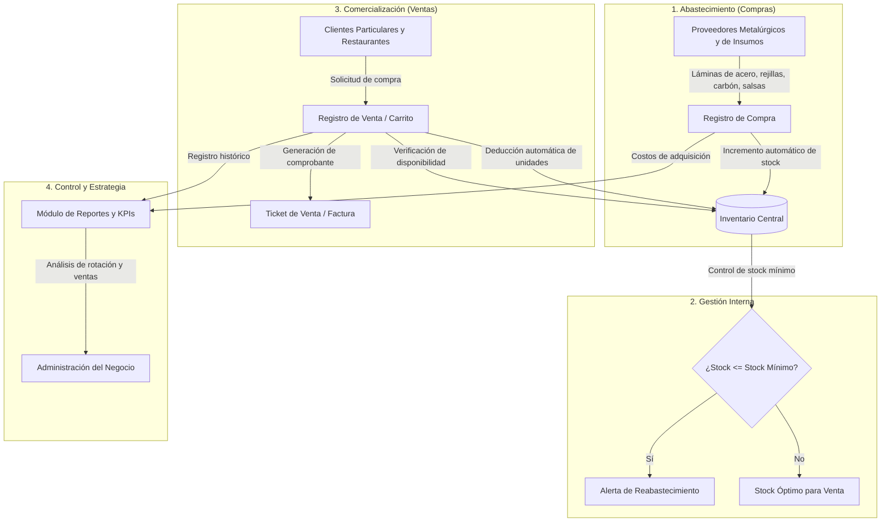

# CAPÍTULO 5. MODELO DEL NEGOCIO Y ROLES DE USUARIO

## 5.1. Modelo del Negocio (Volcano Barriles)
El modelo de negocio de Volcano Barriles abarca la cadena de valor completa desde el abastecimiento de materia prima hasta la comercialización minorista y mayorista de equipos de asado.

### Operaciones Esenciales del Negocio
1.  **Recepción y Registro de Mercancía:** Al ingresar lotes de insumos o barriles ensamblados, el administrador registra la orden en el módulo de compras vinculando al proveedor, los productos, la cantidad y el precio unitario de coste, lo cual eleva en tiempo real el `stock_actual` en el inventario.
2.  **Monitoreo de Inventario y Alertas:** El sistema examina continuamente las existencias frente al `stock_minimo` estipulado (por defecto, 5 unidades para artículos estándar y 3 para barriles grandes). Cuando el stock es crítico, se visualiza en un panel de alertas destacado.
3.  **Atención de Ventas en Mostrador:** El vendedor atiende al cliente, selecciona su identificación o lo registra si es nuevo, selecciona los productos en la lista interactiva, digita la cantidad requerida (validando que no supere la existencia física) y añade los ítems al carrito temporal.
4.  **Procesamiento Atómico de la Venta:** Al confirmar la venta, se guarda el encabezado en la tabla `venta`, los ítems en `detalle_venta` y se descuentan de forma transaccional e inmediata las cantidades vendidas en la tabla `producto`.

---

## 5.2. Definición de Roles de Usuario y Matriz de Privilegios
Para preservar la integridad de la información sensible y garantizar la segregación de funciones requerida por las buenas prácticas de seguridad informática, el sistema define **tres roles de usuario mutuamente excluyentes**:

### Descripción de Perfiles

1.  **Rol 1: Administrador**
    *   **Propósito:** Propietario o gerente general del establecimiento.
    *   **Responsabilidades:** Supervisión global del negocio, fijación de precios, abastecimiento y negociación con proveedores, gestión de personal (creación, activación y reseteo de usuarios), control integral de inventarios y toma de decisiones comerciales mediante la visualización de reportes históricos.
    *   **Nivel de Privilegios:** Total (Lectura, Escritura, Modificación y Eliminación en todos los módulos).

2.  **Rol 2: Vendedor / Cajero**
    *   **Propósito:** Personal de atención en mostrador y gestión de pedidos.
    *   **Responsabilidades:** Atención directa al público, registro y actualización de datos de clientes, cotización y procesamiento de ventas en el carrito de compras, consulta de disponibilidad de stock e impresión de comprobantes.
    *   **Nivel de Privilegios:** Operativo comercial (Creación y consulta de clientes, registro de ventas, consulta de catálogo e inventario). Tiene **restringido** el acceso a compras a proveedores, edición de categorías de productos, mantenimiento de usuarios del sistema y borrado masivo de catálogo.

3.  **Rol 3: Consultor / Auditor**
    *   **Propósito:** Revisor fiscal, auditor externo o pasante administrativo.
    *   **Responsabilidades:** Inspección visual de inventarios, verificación de existencias críticas para auditoría y consulta de reportes estadísticos de ventas.
    *   **Nivel de Privilegios:** Solo lectura (*Read-Only*). No tiene capacidad de registrar ventas, compras, alterar datos de clientes ni modificar parámetros de configuración.

---

### Matriz de Permisos por Módulo y Rol

| Módulo del Sistema | Operación | Administrador (Rol 1) | Vendedor (Rol 2) | Consultor (Rol 3) |
| :--- | :--- | :---: | :---: | :---: |
| **Autenticación (Login)** | Iniciar sesión y validar credenciales SHA-256 | ✅ Permitido | ✅ Permitido | ✅ Permitido |
| **Gestión de Productos** | Consultar catálogo y filtrar por categoría | ✅ Permitido | ✅ Permitido | ✅ Permitido (Solo lectura) |
| | Crear, modificar o eliminar productos | ✅ Permitido | ✅ Permitido | ❌ Denegado |
| **Gestión de Clientes** | Consultar clientes por DNI o nombre | ✅ Permitido | ✅ Permitido | ❌ Denegado |
| | Crear o editar fichas de clientes | ✅ Permitido | ✅ Permitido | ❌ Denegado |
| | Eliminar registros de clientes | ✅ Permitido | ❌ Denegado | ❌ Denegado |
| **Gestión de Proveedores** | CRUD completo de empresas proveedoras | ✅ Permitido | ❌ Denegado | ❌ Denegado |
| **Gestión de Categorías** | CRUD completo de categorías de catálogo | ✅ Permitido | ❌ Denegado | ❌ Denegado |
| **Módulo de Usuarios** | Gestión de usuarios, roles y contraseñas | ✅ Permitido | ❌ Denegado | ❌ Denegado |
| **Módulo de Ventas** | Procesar ventas y descontar inventario | ✅ Permitido | ✅ Permitido | ❌ Denegado |
| | Anular o consultar historial de ventas | ✅ Permitido | ✅ Permitido | ❌ Denegado |
| **Módulo de Compras** | Registrar compras a proveedores y subir stock | ✅ Permitido | ❌ Denegado | ❌ Denegado |
| **Control de Inventario** | Consultar existencias y alertas de stock bajo | ✅ Permitido | ✅ Permitido | ✅ Permitido |
| **Reportes y KPIs** | Consultar métricas, totales por fecha y top ventas| ✅ Permitido | ✅ Permitido | ✅ Permitido |
