# CAPÍTULO 6. DIAGRAMA DE CLASES (UML 2.5)

El diseño orientado a objetos del sistema **SIGEIV-Volcano** se fundamenta en la arquitectura por capas **Modelo-Vista-Controlador (MVC)**, complementada con el patrón de acceso a datos **DAO (Data Access Object)** y el patrón creacional **Singleton** para la gestión de conexiones a la base de datos relacional.

## 6.1. Estructura de Clases del Dominio y Capas

El sistema se compone de los siguientes paquetes organizados en el espacio de nombres `com.sigeiv`:

*   **`com.sigeiv.modelo`:** Contiene las clases de entidad (POJOs) que representan las entidades del negocio, con atributos estrictamente privados (`-`), constructores sobrecargados y métodos de acceso y encapsulamiento públicos (`+`).
*   **`com.sigeiv.dao`:** Implementa la persistencia de datos mediante sentencias SQL parametrizadas (`PreparedStatement`) sobre JDBC.
*   **`com.sigeiv.controlador`:** Encapsula la lógica de negocio, validación de sesiones activas, autenticación criptográfica y verificación de privilegios de usuario.
*   **`com.sigeiv.util`:** Provee funciones transversales de seguridad (algoritmo SHA-256 para almacenamiento de credenciales).

---

## 6.2. Diagrama de Clases UML Completo

```mermaid
classDiagram
    direction TB

    %% ==========================================
    %% CAPA MODELO (POJOs)
    %% ==========================================
    class Rol {
        -int idRol
        -String nombreRol
        +Rol()
        +Rol(int idRol, String nombreRol)
        +getIdRol() int
        +setIdRol(int idRol) void
        +getNombreRol() String
        +setNombreRol(String nombreRol) void
        +toString() String
    }

    class Usuario {
        -int idUsuario
        -String nombreUsuario
        -String username
        -String contrasena
        -int idRol
        -boolean activo
        +Usuario()
        +Usuario(int idUsuario, String nombreUsuario, String username, String contrasena, int idRol, boolean activo)
        +getIdUsuario() int
        +setIdUsuario(int idUsuario) void
        +getNombreUsuario() String
        +setNombreUsuario(String nombreUsuario) void
        +getUsername() String
        +setUsername(String username) void
        +getContrasena() String
        +setContrasena(String contrasena) void
        +getIdRol() int
        +setIdRol(int idRol) void
        +isActivo() boolean
        +setActivo(boolean activo) void
    }

    class Categoria {
        -int idCategoria
        -String nombreCategoria
        -String descripcion
        +Categoria()
        +Categoria(int idCategoria, String nombreCategoria, String descripcion)
        +getIdCategoria() int
        +setIdCategoria(int idCategoria) void
        +getNombreCategoria() String
        +setNombreCategoria(String nombreCategoria) void
        +getDescripcion() String
        +setDescripcion(String descripcion) void
        +toString() String
    }

    class Proveedor {
        -int idProveedor
        -String empresa
        -String contacto
        -String telefono
        +Proveedor()
        +Proveedor(int idProveedor, String empresa, String contacto, String telefono)
        +getIdProveedor() int
        +setIdProveedor(int idProveedor) void
        +getEmpresa() String
        +setEmpresa(String empresa) void
        +getContacto() String
        +setContacto(String contacto) void
        +getTelefono() String
        +setTelefono(String telefono) void
        +toString() String
    }

    class Producto {
        -int idProducto
        -String nombreProducto
        -double precio
        -int stockActual
        -int stockMinimo
        -int idCategoria
        -int idProveedor
        -String imgUrl
        +Producto()
        +Producto(int idProducto, String nombreProducto, double precio, int stockActual, int stockMinimo, int idCategoria, int idProveedor, String imgUrl)
        +getIdProducto() int
        +setIdProducto(int idProducto) void
        +getNombreProducto() String
        +setNombreProducto(String nombreProducto) void
        +getPrecio() double
        +setPrecio(double precio) void
        +getStockActual() int
        +setStockActual(int stockActual) void
        +getStockMinimo() int
        +setStockMinimo(int stockMinimo) void
        +getIdCategoria() int
        +setIdCategoria(int idCategoria) void
        +getIdProveedor() int
        +setIdProveedor(int idProveedor) void
        +getImgUrl() String
        +setImgUrl(String imgUrl) void
        +isStockBajo() boolean
        +toString() String
    }

    class Cliente {
        -int idCliente
        -String nombreCliente
        -String dni
        -String telefono
        +Cliente()
        +Cliente(int idCliente, String nombreCliente, String dni, String telefono)
        +getIdCliente() int
        +setIdCliente(int idCliente) void
        +getNombreCliente() String
        +setNombreCliente(String nombreCliente) void
        +getDni() String
        +setDni(String dni) void
        +getTelefono() String
        +setTelefono(String telefono) void
        +toString() String
    }

    class Venta {
        -int idVenta
        -Date fecha
        -int idCliente
        -int idUsuario
        -double total
        +Venta()
        +Venta(int idVenta, Date fecha, int idCliente, int idUsuario, double total)
        +getIdVenta() int
        +setIdVenta(int idVenta) void
        +getFecha() Date
        +setFecha(Date fecha) void
        +getIdCliente() int
        +setIdCliente(int idCliente) void
        +getIdUsuario() int
        +setIdUsuario(int idUsuario) void
        +getTotal() double
        +setTotal(double total) void
    }

    class DetalleVenta {
        -int idDetalle
        -int idVenta
        -int idProducto
        -int cantidad
        -double precioUnitario
        -double subtotal
        +DetalleVenta()
        +DetalleVenta(int idDetalle, int idVenta, int idProducto, int cantidad, double precioUnitario, double subtotal)
        +getIdDetalle() int
        +setIdDetalle(int idDetalle) void
        +getIdVenta() int
        +setIdVenta(int idVenta) void
        +getIdProducto() int
        +setIdProducto(int idProducto) void
        +getCantidad() int
        +setCantidad(int cantidad) void
        +getPrecioUnitario() double
        +setPrecioUnitario(double precioUnitario) void
        +getSubtotal() double
        +setSubtotal(double subtotal) void
    }

    class Compra {
        -int idCompra
        -Date fecha
        -double total
        -int idProveedor
        -int idUsuario
        +Compra()
        +Compra(int idCompra, Date fecha, double total, int idProveedor, int idUsuario)
        +getIdCompra() int
        +setIdCompra(int idCompra) void
        +getFecha() Date
        +setFecha(Date fecha) void
        +getTotal() double
        +setTotal(double total) void
        +getIdProveedor() int
        +setIdProveedor(int idProveedor) void
        +getIdUsuario() int
        +setIdUsuario(int idUsuario) void
    }

    class DetalleCompra {
        -int idDetalleCompra
        -int idCompra
        -int idProducto
        -int cantidad
        -double precioUnitario
        +DetalleCompra()
        +DetalleCompra(int idDetalleCompra, int idCompra, int idProducto, int cantidad, double precioUnitario)
        +getIdDetalleCompra() int
        +setIdDetalleCompra(int idDetalleCompra) void
        +getIdCompra() int
        +setIdCompra(int idCompra) void
        +getIdProducto() int
        +setIdProducto(int idProducto) void
        +getCantidad() int
        +setCantidad(int cantidad) void
        +getPrecioUnitario() double
        +setPrecioUnitario(double precioUnitario) void
    }

    %% ==========================================
    %% CAPA CONTROLADOR Y UTILIDAD
    %% ==========================================
    class UsuarioController {
        -UsuarioDAO usuarioDAO
        -Usuario usuarioLogueado
        +autenticar(String username, String password) Usuario
        +registrar(String nombre, String username, String password, int idRol) boolean
        +tieneRol(int idRol) boolean
        +esAdmin() boolean
        +esVendedor() boolean
        +esConsultor() boolean
        +puedeEscribir() boolean
        +getUsuarioLogueado() Usuario
        +cerrarSesion() void
    }

    class HashUtil {
        +sha256(String texto)$ String
    }

    class ConexionDB {
        -String URL$
        -ConexionDB instancia$
        -Connection conexion
        -ConexionDB()
        +getInstancia()$ ConexionDB
        +getConexion() Connection
        -inicializarBaseDeDatos() void
        +cerrarConexion() void
    }

    %% ==========================================
    %% CAPA DAO (Persistencia)
    %% ==========================================
    class ProductoDAO {
        -ConexionDB conexionDB
        +insertar(Producto p) boolean
        +actualizar(Producto p) boolean
        +eliminar(int id) boolean
        +buscarPorId(int id) Producto
        +listarTodos() List~Producto~
        +buscarPorNombre(String nombre) List~Producto~
        +buscarPorCategoria(int idCat) List~Producto~
        +buscarPorProveedor(int idProv) List~Producto~
        +productosStockBajo() List~Producto~
        +actualizarStock(int idProd, int cant) boolean
        +actualizarStockCompra(int idProd, int cant) boolean
    }

    class VentaDAO {
        -ConexionDB conexionDB
        +insertar(Venta v) boolean
        +actualizar(Venta v) boolean
        +eliminar(int id) boolean
        +buscarPorId(int id) Venta
        +listarTodos() List~Venta~
        +buscarPorFechas(Date inicio, Date fin) List~Venta~
        +totalVentasPorFechas(Date inicio, Date fin) double
        +contarVentasPorFechas(Date inicio, Date fin) int
    }

    class CompraDAO {
        -ConexionDB conexionDB
        +insertar(Compra c) boolean
        +actualizar(Compra c) boolean
        +eliminar(int id) boolean
        +buscarPorId(int id) Compra
        +listarTodos() List~Compra~
        +buscarPorFechas(Date inicio, Date fin) List~Compra~
    }

    class ClienteDAO {
        -ConexionDB conexionDB
        +insertar(Cliente c) boolean
        +actualizar(Cliente c) boolean
        +eliminar(int id) boolean
        +buscarPorId(int id) Cliente
        +listarTodos() List~Cliente~
        +buscarPorDni(String dni) Cliente
        +buscarPorNombre(String nombre) List~Cliente~
    }

    class UsuarioDAO {
        -ConexionDB conexionDB
        +insertar(Usuario u) boolean
        +actualizar(Usuario u) boolean
        +eliminar(int id) boolean
        +buscarPorId(int id) Usuario
        +buscarPorUsername(String username) Usuario
        +listarTodos() List~Usuario~
    }

    %% ==========================================
    %% RELACIONES ENTRE ENTIDADES
    %% ==========================================
    Rol "1" <-- "0..*" Usuario : asignado_a
    Usuario "1" <-- "0..*" Venta : registra
    Usuario "1" <-- "0..*" Compra : realiza
    Cliente "1" <-- "0..*" Venta : asociada_a
    Proveedor "1" <-- "0..*" Compra : suministra_en
    Proveedor "1" <-- "0..*" Producto : provee
    Categoria "1" <-- "0..*" Producto : clasifica

    Venta "1" *-- "1..*" DetalleVenta : contiene
    Producto "1" <-- "0..*" DetalleVenta : referencia

    Compra "1" *-- "1..*" DetalleCompra : contiene
    Producto "1" <-- "0..*" DetalleCompra : referencia

    %% ==========================================
    %% RELACIONES CON CONTROLADOR Y SERVICIOS
    %% ==========================================
    UsuarioController ..> UsuarioDAO : utiliza
    UsuarioController ..> HashUtil : cifra_con
    UsuarioController --> Usuario : gestiona_sesion
    ProductoDAO ..> ConexionDB : obtiene_conexion
    VentaDAO ..> ConexionDB : obtiene_conexion
    CompraDAO ..> ConexionDB : obtiene_conexion
    ClienteDAO ..> ConexionDB : obtiene_conexion
    UsuarioDAO ..> ConexionDB : obtiene_conexion
```

---

## 6.3. Justificación de Tipos y Relaciones
*   **Composición estricta (`*--`):** Se definió una relación de composición entre `Venta` y `DetalleVenta`, así como entre `Compra` y `DetalleCompra`, ya que los renglones de detalle carecen de existencia independiente fuera del documento transaccional de cabecera. Si una venta es eliminada en el sistema, sus detalles se eliminan en cascada.
*   **Asociación simple (`<--`):** Las relaciones entre `Producto` y `Categoria`, o entre `Usuario` y `Rol`, corresponden a asociaciones directas donde la clase hija conoce a su referencia padre mediante un identificador foráneo, sin dependencia de ciclo de vida existencial.
*   **Encapsulamiento integral:** Ningún atributo de entidad es accesible directamente; la totalidad de lecturas y modificaciones se canalizan por métodos getters y setters debidamente tipados, garantizando la consistencia del estado del objeto y la posibilidad de insertar validaciones defensivas de negocio.
