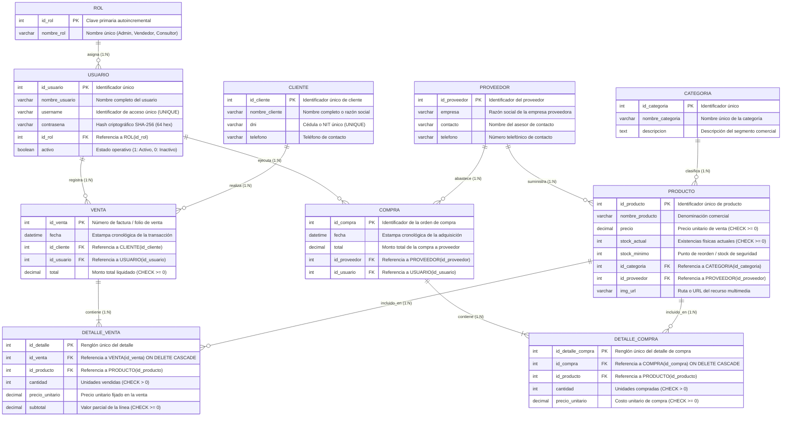

# CAPÍTULO 7. MODELO ENTIDAD-RELACIÓN (DER) Y DISEÑO FÍSICO

El modelo de datos relacional para el sistema **SIGEIV-Volcano** ha sido estructurado para garantizar la integridad referencial, eliminar redundancias anómalas de inserción, actualización o borrado, y optimizar las consultas transaccionales de alto tráfico (ventas, compras y control de inventario).

## 7.1. Diagrama Entidad-Relación (DER) Lógico y Físico

---

## 7.2. Especificación de Entidades y Diccionario de Datos

### Tabla 1. Especificación de la entidad `ROL`
| Atributo | Tipo de Dato | Nulidad | Clave | Restricciones / Descripción |
| :--- | :--- | :---: | :---: | :--- |
| `id_rol` | INTEGER | NOT NULL | PK | Identificador numérico autoincremental único. |
| `nombre_rol` | VARCHAR(50) | NOT NULL | UNIQUE | Nombre del perfil: Administrador, Vendedor, Consultor. |

### Tabla 2. Especificación de la entidad `USUARIO`
| Atributo | Tipo de Dato | Nulidad | Clave | Restricciones / Descripción |
| :--- | :--- | :---: | :---: | :--- |
| `id_usuario` | INTEGER | NOT NULL | PK | Identificador único autoincremental de usuario. |
| `nombre_usuario` | VARCHAR(100) | NOT NULL | - | Nombre y apellido del colaborador. |
| `username` | VARCHAR(50) | NOT NULL | UNIQUE | Nombre de usuario único para inicio de sesión. |
| `contrasena` | VARCHAR(255) | NOT NULL | - | Hash criptográfico generado mediante algoritmo SHA-256. |
| `id_rol` | INTEGER | NOT NULL | FK | Referencia a `ROL(id_rol)` con integridad referencial. |
| `activo` | BOOLEAN | NOT NULL | - | Estado del usuario en el sistema (1 = Activo, 0 = Inactivo). |

### Tabla 3. Especificación de la entidad `CATEGORIA`
| Atributo | Tipo de Dato | Nulidad | Clave | Restricciones / Descripción |
| :--- | :--- | :---: | :---: | :--- |
| `id_categoria` | INTEGER | NOT NULL | PK | Identificador numérico único de la categoría. |
| `nombre_categoria` | VARCHAR(80) | NOT NULL | UNIQUE | Nombre de la categoría (Barriles, Carbón, Accesorios, etc.). |
| `descripcion` | TEXT | NULL | - | Descripción detallada del grupo de artículos. |

### Tabla 4. Especificación de la entidad `PROVEEDOR`
| Atributo | Tipo de Dato | Nulidad | Clave | Restricciones / Descripción |
| :--- | :--- | :---: | :---: | :--- |
| `id_proveedor` | INTEGER | NOT NULL | PK | Identificador numérico único del proveedor. |
| `empresa` | VARCHAR(150) | NOT NULL | - | Razón social o denominación comercial de la empresa. |
| `contacto` | VARCHAR(100) | NULL | - | Nombre de la persona o asesor de contacto directo. |
| `telefono` | VARCHAR(20) | NULL | - | Teléfono o número celular de atención comercial. |

### Tabla 5. Especificación de la entidad `PRODUCTO`
| Atributo | Tipo de Dato | Nulidad | Clave | Restricciones / Descripción |
| :--- | :--- | :---: | :---: | :--- |
| `id_producto` | INTEGER | NOT NULL | PK | Identificador numérico único del producto. |
| `nombre_producto` | VARCHAR(150) | NOT NULL | - | Nombre comercial del artículo (ej. Barril Asador 200L). |
| `precio` | DECIMAL(10,2) | NOT NULL | - | Precio unitario al público (Restricción CHECK: precio >= 0). |
| `stock_actual` | INTEGER | NOT NULL | - | Cantidad física en bodega (Restricción CHECK: stock >= 0). |
| `stock_minimo` | INTEGER | NOT NULL | - | Nivel mínimo de seguridad (Default 5, CHECK >= 0). |
| `id_categoria` | INTEGER | NOT NULL | FK | Referencia a `CATEGORIA(id_categoria)`. |
| `id_proveedor` | INTEGER | NOT NULL | FK | Referencia a `PROVEEDOR(id_proveedor)`. |
| `img_url` | VARCHAR(255) | NULL | - | Ruta o enlace a la imagen del producto. |

### Tabla 6. Especificación de la entidad `CLIENTE`
| Atributo | Tipo de Dato | Nulidad | Clave | Restricciones / Descripción |
| :--- | :--- | :---: | :---: | :--- |
| `id_cliente` | INTEGER | NOT NULL | PK | Identificador numérico único de cliente. |
| `nombre_cliente` | VARCHAR(150) | NOT NULL | - | Nombre de la persona o establecimiento cliente. |
| `dni` | VARCHAR(20) | NULL | UNIQUE | Cédula de ciudadanía o NIT del cliente. |
| `telefono` | VARCHAR(20) | NULL | - | Teléfono móvil o fijo de contacto. |

### Tabla 7. Especificación de la entidad `VENTA`
| Atributo | Tipo de Dato | Nulidad | Clave | Restricciones / Descripción |
| :--- | :--- | :---: | :---: | :--- |
| `id_venta` | INTEGER | NOT NULL | PK | Número consecutivo de venta / factura. |
| `fecha` | DATETIME | NOT NULL | - | Fecha y hora exacta de la transacción (CURRENT_TIMESTAMP). |
| `id_cliente` | INTEGER | NOT NULL | FK | Referencia a `CLIENTE(id_cliente)`. |
| `id_usuario` | INTEGER | NOT NULL | FK | Referencia a `USUARIO(id_usuario)` (vendedor/cajero). |
| `total` | DECIMAL(10,2) | NOT NULL | - | Monto total liquidado de la venta (CHECK >= 0). |

### Tabla 8. Especificación de la entidad `DETALLE_VENTA`
| Atributo | Tipo de Dato | Nulidad | Clave | Restricciones / Descripción |
| :--- | :--- | :---: | :---: | :--- |
| `id_detalle` | INTEGER | NOT NULL | PK | Identificador único del renglón de detalle. |
| `id_venta` | INTEGER | NOT NULL | FK | Referencia a `VENTA(id_venta)` con eliminación en cascada. |
| `id_producto` | INTEGER | NOT NULL | FK | Referencia a `PRODUCTO(id_producto)` con eliminación restringida. |
| `cantidad` | INTEGER | NOT NULL | - | Unidades despachadas en la línea (CHECK cantidad > 0). |
| `precio_unitario` | DECIMAL(10,2) | NOT NULL | - | Precio unitario congelado al momento de la venta (CHECK >= 0). |
| `subtotal` | DECIMAL(10,2) | NOT NULL | - | Monto calculado de la línea: precio * cantidad (CHECK >= 0). |

### Tabla 9. Especificación de la entidad `COMPRA`
| Atributo | Tipo de Dato | Nulidad | Clave | Restricciones / Descripción |
| :--- | :--- | :---: | :---: | :--- |
| `id_compra` | INTEGER | NOT NULL | PK | Identificador de la compra de abastecimiento. |
| `fecha` | DATETIME | NOT NULL | - | Fecha y hora del registro de la compra. |
| `total` | DECIMAL(10,2) | NOT NULL | - | Valor total facturado por el proveedor (CHECK >= 0). |
| `id_proveedor` | INTEGER | NOT NULL | FK | Referencia a `PROVEEDOR(id_proveedor)`. |
| `id_usuario` | INTEGER | NOT NULL | FK | Referencia a `USUARIO(id_usuario)` que registró la compra. |

### Tabla 10. Especificación de la entidad `DETALLE_COMPRA`
| Atributo | Tipo de Dato | Nulidad | Clave | Restricciones / Descripción |
| :--- | :--- | :---: | :---: | :--- |
| `id_detalle_compra`| INTEGER | NOT NULL | PK | Identificador único de la línea de compra. |
| `id_compra` | INTEGER | NOT NULL | FK | Referencia a `COMPRA(id_compra)` con eliminación en cascada. |
| `id_producto` | INTEGER | NOT NULL | FK | Referencia a `PRODUCTO(id_producto)`. |
| `cantidad` | INTEGER | NOT NULL | - | Unidades ingresadas al almacén (CHECK cantidad > 0). |
| `precio_unitario` | DECIMAL(10,2) | NOT NULL | - | Costo unitario de compra fijado por el proveedor. |

---

## 7.3. Justificación de Cardinalidades y Normalización (3FN)

### Análisis de Cardinalidades y Participaciones
1.  **`ROL` - `USUARIO` (1:N):** Un rol puede ser asignado a muchos usuarios ($0..\text{N}$), pero cada usuario debe pertenecer obligatoriamente a exactamente un rol ($1..1$). Participación total del lado de Usuario.
2.  **`CATEGORIA` - `PRODUCTO` (1:N):** Una categoría agrupa de cero a múltiples productos ($0..\text{N}$), y cada producto debe pertenecer a una sola categoría ($1..1$).
3.  **`PROVEEDOR` - `PRODUCTO` (1:N):** Un proveedor provee múltiples productos del catálogo ($0..\text{N}$), manteniendo un proveedor principal por ítem para reposición directa.
4.  **`VENTA` - `DETALLE_VENTA` (1:N, Composición):** Una venta contiene obligatoriamente al menos un renglón de detalle ($1..\text{N}$), y cada detalle pertenece en exclusiva a una única venta ($1..1$). Si la cabecera desaparece, sus renglones se eliminan (`ON DELETE CASCADE`).
5.  **`PRODUCTO` - `DETALLE_VENTA` (1:N):** Un producto puede figurar en múltiples detalles de diferentes ventas ($0..\text{N}$). Su borrado está protegido (`ON DELETE RESTRICT`) para no corromper el historial contable.

### Cumplimiento de Formas Normales
*   **Primera Forma Normal (1FN):** Todos los atributos son atómicos e indivisibles. No existen grupos repetitivos ni listas incrustadas dentro de un solo campo; los productos de una orden de venta o compra se descomponen en entidades separadas de detalle (`DETALLE_VENTA` y `DETALLE_COMPRA`).
*   **Segunda Forma Normal (2FN):** El esquema cumple la 1FN y todos los atributos no clave tienen dependencia funcional completa respecto a la llave primaria de su tabla, sin existir dependencias parciales sobre claves compuestas.
*   **Tercera Forma Normal (3FN):** El modelo cumple la 2FN y no existen dependencias transitivas; ningún atributo no clave depende funcionalmente de otro atributo no clave. Por ejemplo, los datos del cliente (`nombre_cliente`, `dni`) residen en la entidad `CLIENTE` y en `VENTA` únicamente se almacena la llave foránea `id_cliente`.
